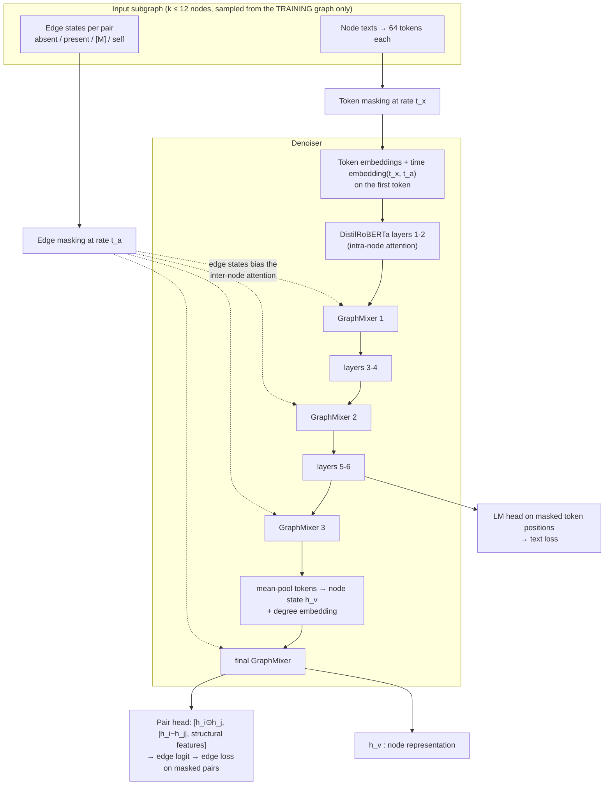
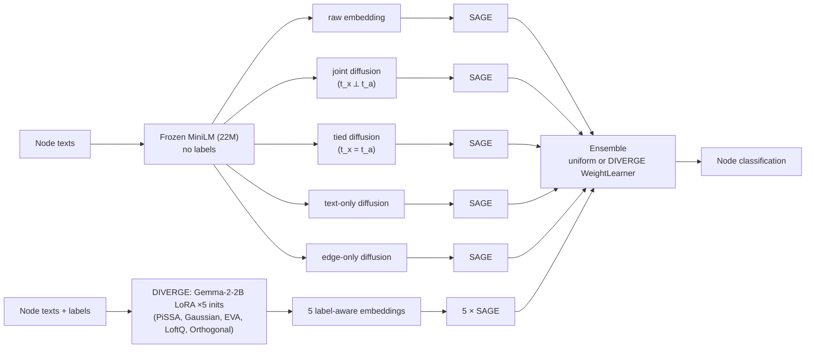

# TwinMask — Joint Masked Diffusion over Text and Topology in Text-Attributed Graphs

> **Status: research prototype, work in progress (last updated 2026-11-16).**
> Phases 0–3 of the plan are implemented and have been run, and the DIVERGE-style ensemble study is complete for Cora and CiteSeer (4 seeds, fair tuning). Phases 1–3 use a single seed. Negative and mixed findings are reported on purpose; see [Limitations](#9-limitations-and-honest-assessment).

---

## TwinMask V3 · Counterfactual utility and selective message passing

V3 asks whether local evidence removal improves masked token and edge reconstruction, and how much of the oracle gain a selector can recover from observations alone. This pilot freezes the V2 denoiser and intervenes in its final GraphSAGE aggregation. Each token target has up to four sampled incoming messages. Each edge candidate has up to two sampled incoming messages at each endpoint, and the edge experiment gates the direct pooled-text term of those messages. Indirect text paths, degree normalization, the observed graph, and messages outside the sampled panel stay fixed. The budget applies to the panel.

The runner measures leave-one-out loss changes, exact Shapley values over the at-most-four-slot panel, and signed pair interactions. Separate lightweight utility networks for text and edge use Huber and ranking losses. A reconstruction-trained gate with the same scoring architecture serves as a control. The budgeted comparisons use matched counts for random, semantic similarity, predicted utility, redundancy-penalized utility, and predicted synergy. The unconstrained-count oracle can use any subset of size at most K. A second oracle uses the matched count. Oracle scores use target labels for diagnostics. Learned selectors are fitted on controller cases and choose test weights from observable features.

### Related work and overlap

| Primary source | What overlaps and what V3 measures |
|---|---|
| [SGUL, ICLR 2025](https://arxiv.org/html/2503.18195v1) | The closest overlap for learning neighbor value without test labels. SGUL values neighbor subsets using a learned utility tied to inference accuracy and Shapley features. The V3 pilot estimates signed loss changes for two masked reconstruction targets. |
| [Efficient Modality Selection, JMLR 2024](https://jmlr.org/papers/v25/23-0439.html) | Uses Shapley and marginal utility for cardinality-constrained modality selection, with guarantees under its assumptions. V3 enumerates small message panels, including potentially negative and interacting utility. |
| [GraphMask, ICLR 2021](https://arxiv.org/html/2010.00577) | Trains differentiable message masks to explain which messages a frozen GNN can omit while preserving behavior. V3 compares reconstruction loss changes under fixed-normalization message suppression. |
| [NeuralSparse, ICML 2020](https://proceedings.mlr.press/v119/zheng20d.html) and [PASS, KDD 2021](https://blog.ml.cmu.edu/2021/12/03/pass-performance-adaptive-sampling-strategy-for-graph-convolutional-networks/) | Learn task-relevant sparsification or neighbor sampling. The pilot's reconstruction-trained gate is a local control. Equal-protocol reproductions of the published methods remain open. |
| [UDPD, ICML 2026](https://proceedings.mlr.press/v306/yu26ab.html) | Already modulates cross-modal interaction by uncertainty in continuous embedding diffusion for node classification. V3 studies local counterfactual evidence for discrete reconstruction under separate masking rates. |

These overlaps leave the paper's candidate contribution in the **measurement and mitigation of direction-specific harmful evidence under incomplete text and structure**, with equal-budget controls. Establishing novelty and improvement requires stronger same-protocol comparisons.

<!-- research-v3-results -->

### Ten-seed results

Seeds 42–51, four asymmetric corruption cases per seed, and up to 768 sampled targets per task and case. The test cases use saved V2 masks. Lower token CE and edge BCE are better. Each cell is a mean over cases and seeds.

| Dataset | Direction | Full | Random K=2 | Direct gate top-2 | Learned top-2 | Learned redundancy + synergy K=2 | Oracle matched K=2 | Oracle at most 2 |
|---|---|---:|---:|---:|---:|---:|---:|---:|
| Cora | text | 4.8499 | 4.8496 | 4.8490 | 4.8492 | 4.8493 | 4.8333 | 4.7882 |
| Cora | edge | 0.6465 | 0.6483 | 0.6480 | 0.6471 | 0.6477 | 0.6132 | 0.6044 |
| CiteSeer | text | 5.1818 | 5.1819 | 5.1814 | 5.1815 | 5.1816 | 5.1734 | 5.1151 |
| CiteSeer | edge | 0.6468 | 0.6489 | 0.6483 | 0.6479 | 0.6477 | 0.6191 | 0.5943 |
| PubMed | text | 3.9951 | 3.9945 | 3.9942 | 3.9942 | 3.9944 | 3.9884 | 3.9512 |
| PubMed | edge | 0.4940 | 0.4929 | 0.4925 | 0.4907 | 0.4915 | 0.4692 | 0.4599 |

Paired intervals use the ten seed means within each graph and quantify run variability on that graph.

| Dataset | Direction | Oracle at most 2 minus full [95% CI] | Learned top-2 minus direct gate top-2 [95% CI] | LOO Spearman |
|---|---|---:|---:|---:|
| Cora | text | -0.0617 [-0.0720, -0.0513] | +0.0001 [-0.0002, +0.0004] | 0.033 |
| Cora | edge | -0.0420 [-0.0522, -0.0319] | -0.0009 [-0.0031, +0.0013] | 0.023 |
| CiteSeer | text | -0.0667 [-0.0766, -0.0567] | +0.0000 [-0.0002, +0.0003] | 0.043 |
| CiteSeer | edge | -0.0524 [-0.0682, -0.0366] | -0.0003 [-0.0017, +0.0011] | 0.052 |
| PubMed | text | -0.0439 [-0.0507, -0.0371] | +0.0000 [-0.0001, +0.0002] | 0.083 |
| PubMed | edge | -0.0341 [-0.0414, -0.0267] | -0.0018 [-0.0028, -0.0008] | 0.115 |

The oracle with an up-to-two budget improved both losses on all three datasets. The learned selectors recovered only a small share of the diagnostic oracle gap. Weak positive rank correlation and the comparison with direct supervision temper any claim for the utility or synergy objective. The current audit scores all subsets of a small panel after full-graph encoding, so its runtime measures the research experiment. The selected message counts do not establish inference speedup.


Detailed curves for budgets 1–4, hard/soft gates, oracle Shapley ranking, interaction magnitude, accuracy, perplexity, AUROC, AP, and per-seed runtimes. Fitted selectors are stored locally under `checkpoints/research_twinmask_v3/`. [Cora](results/research_twinmask_v3/cora.json) [CiteSeer](results/research_twinmask_v3/citeseer.json) [PubMed](results/research_twinmask_v3/pubmed.json)

This pilot uses the compact V2 checkpoints and a one-shot final-layer intervention. Multi-step diffusion integration, larger message panels, node classification, GAT/GraphMask/NeuralSparse/PASS reproductions, synthetic-shift generalization, and deployment latency remain future tests.

```powershell
python -m scripts.research_twinmask_v3 --seeds 42 43 44 45 46 47 48 49 50 51
python -m unittest scripts.test_research_pilots scripts.test_research_twinmask_v3 -v
```

## Research correction and directional conditioning (V2)

**Working title.** When Text and Topology Disagree: Adaptive Cross-Modal Conditioning for Incomplete Text-Attributed Graphs.

The earlier sparse TwinMask run conditioned on the fraction of *initially masked targets* still pending. Both clocks therefore started at 1 for every nonempty modality, including in training. V2 starts each clock at its own nominal corruption rate and scales it by the fraction of its initial targets still pending. Tied training uses equal initial rates. Both training arms face the same independently masked evaluation cases.

The denoiser is trained on both initially corrupted inputs and short rollouts containing its own detached predictions. The correction policy re-masks the generated block in a separate scoring pass and ranks each generated value by support for that value. Observations remain clamped. The rescoring pass counts against the same four-call budget. In the soft-edge variant, a generated pair contributes to message passing with its predicted probability, while observed positives retain unit weight. The hard-edge control uses thresholded generated edges.

The primary V2 question is whether observed structure helps token recovery and observed text helps link recovery under each missingness pattern. One-shot directional conditioning compares a joint pass, text-only for token reconstruction, structure-only for link reconstruction, and a per-case learned mixture with a separate probability weight for each direction. The learned weights use corruption clocks and uncertainty summaries, with targets fitted on disjoint controller cases. An oracle selects weights against held-out labels for analysis only. One-shot here means no generated feedback. Learned conditioning requires three denoiser passes to produce its joint and unimodal probabilities.

Across ten seeds on Cora, CiteSeer, and PubMed, the learned gate reduced mean token cross-entropy by 0.008, 0.019, and 0.022 respectively. Mean edge binary cross-entropy increased on all three. On PubMed, four-call adaptive reconstruction raised mean token accuracy from 30.68% to 31.12% and edge AUROC from 0.8552 to 0.8589 relative to one-shot. The validation-selected fixed four-call policy reached 31.39% and 0.8601. Cora and CiteSeer had small declines in edge AUROC relative to one-shot. In the symmetric Ensemble comparisons, the accuracy difference between five diffusion views and five Gaussian views stayed within 0.25 percentage points under either classifier protocol.

The strongest literature overlap is UDPD §§3.3–4.1. It explicitly adjusts cross-branch interaction by node uncertainty while denoising two continuous embedding streams and evaluates downstream node classification. TAG-DLM injects topology into a masked diffusion language model and recovers a masked answer token for classification and candidate link decisions. V2 evaluates held-out content-token and candidate-edge reconstruction and directly measures whether removing cross-modal evidence lowers loss. A one-shot probability gate alone establishes no novelty claim. [UDPD](https://proceedings.mlr.press/v306/yu26ab.html) [TAG-DLM](https://arxiv.org/html/2606.31166v1)

<!-- research-v2-results -->

### Corrected experiment results

TwinMask uses seeds 42–51 on the three citation datasets and seeds 42–44 for the ablations, extra datasets, and synthetic cases. Each seed has four jointly scored text/edge mask settings. The matched Ensemble comparison uses seeds 42–44.

#### Ensemble classifier controls

Test accuracy (%) uses the same representations, labeled split, classifier architecture, and training epochs within each comparison. The raw-only head sees only raw embeddings during training. Each matched head sees its own arm's representations and is selected using that arm's mean validation predictive distribution.

| Dataset | Classifier | Diffusion-5 | Gaussian-5 | Raw + shared-4 | Raw + independent-4 |
|---|---|---|---|---|---|
| Cora | Raw-only | 84.81 | 84.87 | 85.24 | 85.06 |
| Cora | Method-matched | 84.93 | 84.69 | 85.06 | 85.06 |
| CiteSeer | Raw-only | 74.35 | 74.40 | 74.82 | 74.71 |
| CiteSeer | Method-matched | 74.76 | 74.76 | 74.56 | 74.71 |
| PubMed | Raw-only | 89.18 | 89.17 | 89.20 | 89.20 |
| PubMed | Method-matched | 89.66 | 89.51 | 89.60 | 89.59 |

Full metrics, denoiser and classifier timing, and ensemble diversity. [Cora](results/research_ensemble_v2/cora.json) [CiteSeer](results/research_ensemble_v2/citeseer.json) [PubMed](results/research_ensemble_v2/pubmed.json)

#### TwinMask clocks, rollout, and correction

Cells report mean token accuracy (%) / edge AUROC. One-shot uses one call. Joint, corrective, and adaptive schedules have four calls, including any rescoring. The fixed policy is selected on development cases.

| Dataset | One-shot | Joint | Corrective | Adaptive | Selected fixed |
|---|---|---|---|---|---|
| Cora | 16.71 / 0.6812 | 17.02 / 0.6798 | 17.05 / 0.6816 | 16.82 / 0.6797 | 16.88 / 0.6799 |
| CiteSeer | 13.29 / 0.6792 | 13.37 / 0.6776 | 13.40 / 0.6781 | 13.47 / 0.6783 | 13.34 / 0.6770 |
| PubMed | 30.68 / 0.8552 | 31.41 / 0.8600 | 31.37 / 0.8600 | 31.12 / 0.8589 | 31.39 / 0.8601 |
| WikiCS | 17.24 / 0.9063 | 16.80 / 0.9058 | 16.82 / 0.9070 | 17.17 / 0.9070 | 17.14 / 0.9066 |
| Reddit | 12.21 / 0.7391 | 12.11 / 0.7389 | 12.15 / 0.7396 | 12.23 / 0.7395 | 12.14 / 0.7394 |
| Instagram | 13.82 / 0.8743 | 14.05 / 0.8744 | 14.10 / 0.8755 | 13.89 / 0.8746 | 14.11 / 0.8748 |


| Dataset | Adaptive comparator | Token accuracy change (pp) [95% CI] | Edge AUROC change [95% CI] |
|---|---|---|---|
| Cora | one shot | +0.1026 [-0.0138, +0.2191] | -0.0015 [-0.0029, -0.0001] |
| Cora | fixed | -0.0665 [-0.3222, +0.1892] | -0.0002 [-0.0023, +0.0019] |
| CiteSeer | one shot | +0.1811 [+0.0113, +0.3508] | -0.0009 [-0.0034, +0.0017] |
| CiteSeer | fixed | +0.1226 [-0.0043, +0.2496] | +0.0013 [-0.0011, +0.0037] |
| PubMed | one shot | +0.4401 [+0.3466, +0.5337] | +0.0037 [+0.0020, +0.0054] |
| PubMed | fixed | -0.2673 [-0.3755, -0.1590] | -0.0011 [-0.0021, -0.0002] |

Ablations use the same first three seed IDs. Mixed and tied refer to clock training. Hard-edge message passing and no-rollout training are separate ablations.

| Dataset | Policy | Mixed | Tied | No rollout | Hard edges |
|---|---|---|---|---|---|
| Cora | one shot | 16.34 / 0.6813 | 16.52 / 0.6942 | 16.24 / 0.6770 | 16.37 / 0.6816 |
| Cora | adaptive | 16.47 / 0.6805 | 16.81 / 0.6924 | 16.01 / 0.6750 | 16.44 / 0.6823 |
| CiteSeer | one shot | 13.10 / 0.6835 | 13.12 / 0.6934 | 12.73 / 0.6712 | 13.12 / 0.6863 |
| CiteSeer | adaptive | 13.30 / 0.6855 | 13.38 / 0.6861 | 12.69 / 0.6623 | 13.25 / 0.6891 |
| PubMed | one shot | 30.54 / 0.8526 | 30.46 / 0.8528 | 30.01 / 0.8535 | 30.53 / 0.8543 |
| PubMed | adaptive | 31.05 / 0.8587 | 30.88 / 0.8593 | 30.50 / 0.8562 | 31.04 / 0.8593 |

Detailed corrected runs. [Cora](results/research_twinmask_v2/cora.json) [CiteSeer](results/research_twinmask_v2/citeseer.json) [PubMed](results/research_twinmask_v2/pubmed.json) [WikiCS](results/research_twinmask_v2/wikics.json) [Reddit](results/research_twinmask_v2/reddit.json) [Instagram](results/research_twinmask_v2/instagram.json)

Detailed ablations. [Cora tied](results/research_twinmask_v2/cora_tied.json) [Cora no rollout](results/research_twinmask_v2/cora_no_rollout.json) [Cora hard](results/research_twinmask_v2/cora_hard.json) [CiteSeer tied](results/research_twinmask_v2/citeseer_tied.json) [CiteSeer no rollout](results/research_twinmask_v2/citeseer_no_rollout.json) [CiteSeer hard](results/research_twinmask_v2/citeseer_hard.json) [PubMed tied](results/research_twinmask_v2/pubmed_tied.json) [PubMed no rollout](results/research_twinmask_v2/pubmed_no_rollout.json) [PubMed hard](results/research_twinmask_v2/pubmed_hard.json)

#### One-shot directional conditioning

Cells report token cross-entropy / edge binary cross-entropy. Lower is better. Each seed contributes the mean over its four cases. The 95% paired t intervals are for learned minus joint loss and treat seeds as the run unit within each graph.

| Dataset | Unimodal | Joint | Learned | Oracle | Token CE paired change [95% CI] | Edge BCE paired change [95% CI] |
|---|---|---|---|---|---|---|
| Cora | 4.8618 / 0.6845 | 4.8598 / 0.6467 | 4.8522 / 0.6506 | 4.8510 / 0.6458 | -0.0076 [-0.0124, -0.0028] | +0.0039 [+0.0008, +0.0069] |
| CiteSeer | 5.1641 / 0.7133 | 5.1780 / 0.6468 | 5.1593 / 0.6503 | 5.1585 / 0.6466 | -0.0188 [-0.0243, -0.0132] | +0.0035 [-0.0001, +0.0071] |
| PubMed | 3.9963 / 0.5672 | 4.0184 / 0.4946 | 3.9960 / 0.4976 | 3.9960 / 0.4946 | -0.0224 [-0.0288, -0.0159] | +0.0030 [-0.0000, +0.0059] |
| WikiCS | 5.0541 / 0.4945 | 5.0585 / 0.4260 | 5.0434 / 0.4260 | 5.0430 / 0.4260 | -0.0151 [-0.0367, +0.0066] | +0.0000 [+0.0000, +0.0000] |
| Reddit | 4.9682 / 0.6171 | 4.9656 / 0.6191 | 4.9627 / 0.6150 | 4.9625 / 0.6130 | -0.0030 [-0.0159, +0.0100] | -0.0041 [-0.0173, +0.0092] |
| Instagram | 5.0314 / 0.5434 | 5.0202 / 0.4770 | 5.0173 / 0.4801 | 5.0170 / 0.4766 | -0.0029 [-0.0065, +0.0007] | +0.0031 [-0.0018, +0.0080] |

Synthetic interventions change expected homophily (0.85 to 0.30), lexical signal (0.80 to 0.20), or add spurious test-context edges (25% of the number of real training edges), one factor at a time. The independently varied text and edge missingness cases are stored in the JSON. A positive evidence gain means that removing the other modality increased loss.

| Synthetic case | Structure to text CE gain | Text to edge BCE gain | Joint CE / BCE | Learned CE / BCE |
|---|---|---|---|---|
| reference | +0.1397 | -0.0827 | 2.7725 / 0.8324 | 2.7736 / 0.5314 |
| low homophily | -0.0671 | -0.0793 | 2.9402 / 0.7740 | 2.8729 / 0.6952 |
| weak text | -0.0038 | -0.0047 | 3.5266 / 0.6981 | 3.5231 / 0.6938 |
| noisy context | +0.1282 | +0.0156 | 2.7994 / 0.7262 | 2.8049 / 0.5362 |

Synthetic runs. [reference](results/research_twinmask_v2/synthetic_reference.json) [low homophily](results/research_twinmask_v2/synthetic_low_homophily.json) [weak text](results/research_twinmask_v2/synthetic_weak_text.json) [noisy context](results/research_twinmask_v2/synthetic_noisy_context.json)

#### Pretrained encoder, alternate split, and text audit


| Cora configuration | Seeds | One-shot accuracy / AUROC | Adaptive accuracy / AUROC | Learned CE / BCE |
|---|---|---|---|---|
| Frozen DistilRoBERTa | 1 | 3.91 / 0.4902 | — | 9.5699 / 0.7205 |
| Full lexical vocabulary smoke test | 1 | 4.69 / 0.5049 | 4.69 / 0.5034 | 10.3883 / 0.7336 |
| Seed-specific link re-splits, CPU | 3 | 16.63 / 0.6878 | 16.75 / 0.6880 | 4.8530 / 0.6455 |

The pretrained directional feasibility run uses 128 token positions, a 256-dimensional graph mixer, five training epochs, all 50,261 RoBERTa lexical IDs, and up to 128 masked token targets per case. The frozen encoder runs on the currently visible text. The CPU vocabulary smoke test uses up to 64 masked token targets per case. Other masked positions stay concealed. The feasibility rows use different encoders and target panels. A multi-seed pretrained comparison remains open. The alternate Cora protocol re-splits warm pairs per seed and preserves held-out positives outside training adjacency.
[Pretrained run](results/research_twinmask_v2/cora_pretrained_full_vocab_directional.json) [Full vocabulary smoke test](results/research_twinmask_v2/cora_full_vocab.json) [Link re-splits](results/research_twinmask_v2/cora_resplit.json)

The cached raw text audit counted blank strings and median whitespace-delimited words. WikiCS had 0 blank among 11,701 texts (median 219 words). Reddit had 0 among 33,434 (median 87). Instagram had 99 among 11,339 (median 16). These counts describe coverage and length. The ogbn-arxiv cache had 0 blanks among 169,343 texts (median 167). Its cached links are undirected and lack an evaluation-ready temporal split, so no ogbn-arxiv V2 result is reported.

#### Reproduction commands

```powershell
python -m scripts.research_ensemble
python -m scripts.research_twinmask --seeds 42 43 44 45 46 47 48 49 50 51
python -m scripts.research_twinmask --clock-training tied
python -m scripts.research_twinmask --no-rollout
python -m scripts.research_twinmask --hard-edges
python -m scripts.research_twinmask --datasets wikics reddit instagram
python -m scripts.research_twinmask --datasets synthetic_reference synthetic_low_homophily synthetic_weak_text synthetic_noisy_context
python -m scripts.research_twinmask --datasets cora --seeds 42 --epochs 5 --encoder hf_models/all-distilroberta-v1 --width 256 --length 128 --full-vocab --max-token-targets 128 --directional-only
python -m scripts.research_twinmask --datasets cora --resplit-links --device cpu
python -m scripts.research_twinmask --datasets cora --seeds 42 --epochs 5 --device cpu --full-vocab --max-token-targets 64
python -m unittest scripts.test_research_pilots -v
python -m scripts.report_research_v2
```

## Research continuation pilots (2026-11-27)

The following is the archived V1 report. Its sparse TwinMask clock comparison predates the correction above. Historical checkpoint replay used a separate implementation and protocol.

Both research proposals were implemented as pilots. Each pilot ran on Cora, CiteSeer, and PubMed with paired seeds 42, 43, and 44 on an NVIDIA GeForce RTX 5070 (12 GiB, PyTorch 2.7.1+cu128). The results do not yet support a diffusion-specific ensemble advantage or an adaptive reconstruction advantage over one-shot inference.

```powershell
python -m scripts.research_ensemble
python -m scripts.research_twinmask
python -m scripts.research_twinmask --clock-training tied
python -m unittest scripts.test_research_pilots -v
```

### Proposal 1. One shared denoiser for multiple views

[Proposal](01_Diffusion_Ensemble_Research.md) and [runner](scripts/research_ensemble.py). This node-classification pilot used cached frozen MiniLM embeddings, training-node standardization, the existing training-edge graph, and seeded random 60/20/20 label splits. The validation set was split in two for head checkpointing and view selection. One GraphSAGE denoiser trained for 100 epochs on Gaussian VP corruption and optional observed-edge dropout. Five deterministic DDIM trajectories used distinct noise seeds and policies, with 18 denoiser calls across the pool. The shared classifier trained on alternating raw and diffusion views. The Gaussian control used the same perturbation seeds and matched each diffusion view's mean cosine to MiniLM. The selector started with the shared raw prediction and added views using validation NLL improvement per call under a nine-call cap, with cosine at least 0.80 and identity retrieval at least 0.90.

Test accuracy in percent (mean ± sample SD across seeds).

| Arm | Cora | CiteSeer | PubMed |
|---|---:|---:|---:|
| Raw MiniLM + GraphSAGE | 85.49 ± 2.22 | 74.76 ± 1.18 | 89.36 ± 0.32 |
| Shared head on raw input | 85.73 ± 2.31 | 74.50 ± 0.86 | 89.70 ± 0.69 |
| One diffusion view | 85.24 ± 2.84 | 74.45 ± 0.72 | 89.78 ± 0.74 |
| Two diffusion views | 85.42 ± 2.60 | 74.66 ± 0.77 | 89.82 ± 0.81 |
| Five diffusion views | 85.12 ± 2.79 | 74.19 ± 1.10 | 89.49 ± 0.83 |
| Five cosine-matched Gaussian views | 85.06 ± 2.58 | 74.14 ± 1.03 | 89.45 ± 0.80 |
| Five MC-dropout predictions | 85.24 ± 2.24 | 74.40 ± 1.27 | 89.43 ± 0.33 |
| Five independently seeded GraphSAGE heads | 85.49 ± 2.44 | 76.54 ± 0.77 | 89.74 ± 0.34 |
| Validation-selected diffusion views + raw | 85.55 ± 2.46 | 74.50 ± 0.65 | 89.70 ± 0.69 |
| One diffusion view at t=30 | 85.06 ± 3.05 | 73.62 ± 1.76 | 88.70 ± 0.55 |
| Fixed-noise autoencoder at t=30 | 84.38 ± 1.66 | 73.41 ± 1.42 | 86.98 ± 0.70 |
| Mean of five diffusion embeddings | 85.30 ± 2.38 | 74.19 ± 0.89 | 89.32 ± 0.66 |
| Raw + four views from one denoiser | 85.24 ± 2.48 | 74.61 ± 1.18 | 89.52 ± 0.79 |
| Raw + four independently trained denoisers | 85.18 ± 2.46 | 74.50 ± 1.42 | 89.53 ± 0.70 |

| Dataset | Diffusion-5 minus Gaussian-5 (pp) | Diffusion-5 / Gaussian-5 / dropout-5 NLL | Selected view counts by seed | One / four denoiser fit median (s) | Peak allocated MiB |
|---|---:|---:|---:|---:|---:|
| Cora | +0.06 | 0.4881 / 0.4887 / 0.4829 | 1, 2, 2 | 0.26 / 1.01 | 131 |
| CiteSeer | +0.05 | 0.8367 / 0.8384 / 0.8376 | 3, 1, 2 | 0.26 / 1.01 | 148 |
| PubMed | +0.03 | 0.2797 / 0.2808 / 0.2842 | 0, 0, 0 | 0.46 / 1.83 | 761 |

On CiteSeer, the independently seeded heads had higher mean accuracy and lower NLL. On PubMed, two diffusion views had the highest mean accuracy among these arms, and the selector added zero views in all three runs. Across datasets, five diffusion views differed from matched Gaussian noise by at most 0.07 percentage points in mean accuracy. The experiment used cached embeddings, so the encoder extraction cost is unavailable. Per-stage timings are exploratory and include GPU warm-up and, for some runs, concurrent activity. With raw input plus four views, the difference between the shared and independently trained denoisers ranged from -0.01 to +0.10 percentage points across datasets. The four independently trained denoisers were evaluated with the same first four sampling policies and the same shared head as the one-denoiser arm. The fixed-noise autoencoder used the same capacity, corruption timestep, noise draw at inference, and classifier as the single-view t=30 comparison. The common classifier was trained on the shared denoiser's views, which may favor that arm. A same-split DIVERGE cost comparison, formal noninferiority, and matched end-to-end compute remain open.

Mean pairwise test prediction disagreement and oracle accuracy. Oracle accuracy counts a node as correct if any member predicts its label and is a diagnostic upper bound.

| Dataset | Diffusion-5 disagreement | Gaussian-5 disagreement | Diffusion-5 oracle accuracy | Gaussian-5 oracle accuracy |
|---|---:|---:|---:|---:|
| Cora | 4.76% | 4.89% | 88.25% | 88.50% |
| CiteSeer | 5.57% | 5.51% | 78.32% | 78.27% |
| PubMed | 5.64% | 5.67% | 93.54% | 93.48% |

Per-seed macro-F1, NLL, Brier, ECE, view identity and cosine, pairwise double fault, error correlation, selected policies, and stage timings are in [Cora](results/research_ensemble/cora.json), [CiteSeer](results/research_ensemble/citeseer.json), and [PubMed](results/research_ensemble/pubmed.json). Local checkpoints under `checkpoints/research_ensemble/` contain the denoiser, splits, test labels, and per-arm and per-member probabilities.

### Proposal 2. Asymmetric conditional graph inpainting

[Proposal](02_TwinMask_Asymmetric_Research.md) and [runner](scripts/research_twinmask.py). The pilot trained a 64-wide token embedding, local token convolution, and two sparse GraphSAGE layers for 120 epochs. It used the first 16 positions after the start token and the 1,024 most frequent tokens in the fitting nodes. Out-of-vocabulary tokens map to a separate symbol and are outside the token reconstruction target set. The full DistilRoBERTa architecture and full-length vocabulary reconstruction remain future work.

Training, controller fitting, and development selection used disjoint token target nodes and disjoint edge target pools. Validation/test positives from the cached graph split were absent from training adjacency. Visible positive pairs were used as message edges, candidate pairs carried explicit unknown/absent/present states, and observed states were clamped throughout inference. The shuffled test candidate list came from the cached reference positives and sampled negatives. As a result, edge AUROC and AP measure ranking within that candidate set. Open-world retrieval remains untested.

The four test cases used random text/edge mask probabilities of (0.25, 0.75), (0.50, 0.50), (0.75, 0.25), and (0.90, 0.90). The ridge controller selected from joint, text-priority, edge-priority, and corrective actions using observable mask fractions, prediction entropies, and remaining calls. Its training targets came from free-running simulated actions scored on a fixed subset kept masked. Corrective remasking was a confidence heuristic capped at 10% of currently generated entries per modality. The last call filled all remaining targets. The fixed comparator was selected per seed using mean development token accuracy plus edge accuracy.

Mean final token accuracy (%) / test candidate edge AUROC across three seeds and four corruption cases. Edge probabilities are taken at the final reveal of each target.

| Policy | Calls | Cora | CiteSeer | PubMed |
|---|---:|---:|---:|---:|
| One-shot | 1 | 16.80 / 0.6882 | 13.40 / 0.6937 | 30.87 / 0.8611 |
| Joint | 4 | 16.42 / 0.6839 | 12.95 / 0.6702 | 30.24 / 0.8522 |
| Text priority | 4 | 16.60 / 0.6836 | 13.12 / 0.6890 | 30.92 / 0.8594 |
| Edge priority | 4 | 16.79 / 0.6865 | 13.20 / 0.6817 | 30.44 / 0.8602 |
| Joint with correction | 4 | 16.34 / 0.6813 | 12.72 / 0.6675 | 30.08 / 0.8508 |
| Entropy | 4 | 16.79 / 0.6865 | 13.20 / 0.6817 | 30.44 / 0.8602 |
| Learned controller | 4 | 16.79 / 0.6865 | 13.24 / 0.6818 | 30.67 / 0.8586 |
| Development-selected fixed | 4 | 16.54 / 0.6826 | 13.23 / 0.6851 | 30.99 / 0.8597 |

| Dataset | Token vocabulary coverage | Structure → text CE gain | Text → edge BCE gain | Dev. action-gain Spearman | One-shot / adaptive latency (ms) |
|---|---:|---:|---:|---:|---:|
| Cora | 71.0% | +0.0225 | +0.0040 | 0.813 | 5.2 / 16.4 |
| CiteSeer | 72.5% | +0.0188 | +0.0526 | 0.802 | 5.4 / 16.9 |
| PubMed | 81.8% | -0.0169 | +0.0638 | 0.904 | 27.9 / 99.5 |

Directional gains measure the increase in initial held-out loss when evidence from the other modality is removed. Positive values favor retaining the observed evidence. In this setting, structure modestly helped Cora and CiteSeer text, while removing it slightly improved PubMed token CE. PubMed and CiteSeer showed larger text-to-edge gains than Cora. The learned policy did not consistently improve over the development-selected fixed policy at equal calls. One-shot had the highest edge AUROC on all three datasets and was faster. The controller correlations summarize pooled development actions and do not establish calibration, cross-graph transfer, or causal effects.

Per-seed and per-case losses, edge AP/Brier/accuracy, token accuracy, directional gains, timing, and action traces are in [Cora](results/research_twinmask/cora.json), [CiteSeer](results/research_twinmask/citeseer.json), and [PubMed](results/research_twinmask/pubmed.json). Local checkpoints under `checkpoints/research_twinmask/` include the model, vocabulary, split indices, candidate masks, and fitted controller coefficients. Candidate retrieval, synthetic interventions, whole-node/span and bridge missingness, full baseline comparisons, and confirmatory multi-split inference remain open.

Before the mandatory final joint fill, the learned policy chose the edge action in 36 of 36 Cora decisions, 32 of 36 CiteSeer decisions, and 19 of 36 PubMed decisions. PubMed also had 15 text and two correction actions. The controller used a wider range of actions on PubMed, where it still trailed one-shot on both primary endpoints.

#### Tied-clock training ablation

The tied control used the same architecture, seeds, training length, and case generation, with both training clocks set to the text clock at every step. The evaluation allowed different text and edge mask rates in both arms. The table reports one-shot token accuracy (%) / edge AUROC.

| Dataset | Mixed-clock training | Tied-clock training |
|---|---:|---:|
| Cora | 16.80 / 0.6882 | 16.67 / 0.6859 |
| CiteSeer | 13.40 / 0.6937 | 13.29 / 0.7033 |
| PubMed | 30.87 / 0.8611 | 30.68 / 0.8644 |

One-shot token accuracy favored mixed-clock training by a small margin on all three datasets. The effect on edge AUROC varied by graph. Full tied-control results include every policy and mask case. [Cora](results/research_twinmask/cora_tied.json) [CiteSeer](results/research_twinmask/citeseer_tied.json) [PubMed](results/research_twinmask/pubmed_tied.json)

#### Historical checkpoint replay

The original seed-0 joint checkpoints were replayed with the repository's cold-node episode builder, 50% text masking, three repeat masks, and free-running generation. The table compares the historical sampler's one-call diagonal token NLL against its best eight-call nonlearned path by token NLL. These values use the legacy scoring and episode protocol separately from the sparse pilot above.

| Dataset | One call | Eight calls, edge_lead2 |
|---|---:|---:|
| Cora | 4.243 | 4.547 |
| PubMed | 2.966 | 3.117 |

Replay outputs include all fixed paths and one- and eight-call sweeps. [Cora](results/research_twinmask/cora_legacy_replay.json) [PubMed](results/research_twinmask/pubmed_legacy_replay.json)

```powershell
python -m twinmask.path_rl --dataset cora --no_policy --sweep 1 8 --output-tag research_twinmask
python -m twinmask.path_rl --dataset pubmed --no_policy --sweep 1 8 --output-tag research_twinmask
```

### Paired pilot estimates

Each contrast uses one paired difference per seed. TwinMask differences average the four masks within each seed before computing the interval. The 95% Student t intervals have two degrees of freedom and describe three resampled splits of the same graph. They provide no cross-graph inference.

| Dataset | Diffusion-5 vs Gaussian-5 accuracy (pp) | Adaptive vs selected fixed token accuracy (pp) | Adaptive vs selected fixed edge AUROC |
|---|---:|---:|---:|
| Cora | +0.06 [-0.47, +0.59] | +0.25 [-0.29, +0.79] | +0.0038 [-0.0112, +0.0188] |
| CiteSeer | +0.05 [-0.17, +0.28] | +0.02 [-0.08, +0.11] | -0.0034 [-0.0143, +0.0076] |
| PubMed | +0.03 [-0.12, +0.19] | -0.33 [-1.10, +0.45] | -0.0011 [-0.0059, +0.0037] |

---

## 1. TL;DR

A **text-attributed graph (TAG)** gives every node a piece of raw text and links nodes with edges. Almost all existing methods encode the text *once* with a language model and then run a GNN on top; text and structure are never modelled **jointly and generatively**.

**TwinMask** treats both modalities as discrete variables and corrupts them with a *single* absorbing-state (mask) diffusion process:

* every **text token** of every node can become `[MASK]`;
* every **edge variable** `e_ij ∈ {absent, present}` can become `[MASK]` ("unknown", which is **not** the same as "absent");
* the two modalities get **independent noise levels** `(t_x, t_a) ∈ [0,1]²`.

One denoiser is trained on the whole square, so one model represents all conditionals at once:

| Conditioning `(t_x, t_a)` | What the model computes | Task |
|---|---|---|
| `t_x = 0`, edge masked | `p(A ∣ X, partial A)` | link prediction |
| `t_x = 0`, all of a node's edges masked | `p(edges of v ∣ text)` | cold-start node attachment |
| `t_a = 0`, text masked | `p(X ∣ A, neighbours' text)` | text completion / imputation |
| `t_x = 1` (text fully masked) | `p(A ∣ partial A)` | link prediction with **missing text** |
| `(1, 1) → (0, 0)` | `p(X, A)` | joint TAG generation (planned) |
| `(0, 0)` | node state `h_v` | representation learning |

To my knowledge (literature search, Nov 2026) no published work diffuses **raw node text tokens and edges together with separate noise levels**. Closest work: TAG-DLM (masks only the answer token of a frozen LLaDA-8B), Mao et al. EMNLP 2026 (autoregressive over Eulerian traversals), UTGDiff (molecules; text only as condition), GraphMaker (attribute *vectors*, not text).

**Headline findings so far** (details in §7):

1. **Robust to a missing modality.** Trained with text masking, TwinMask still ranks edges from structure alone (graph-only link-prediction AUC 57–95 across 7 datasets); an edge-only model collapses to chance (42–46 on Cora/CiteSeer).
2. **"Unknown" ≠ "absent" matters.** Treating masked edges as absent (edge-dropout view) lowers graph-only AUC by up to **5 points** on PubMed (86.9 → 81.9) compared with a dedicated `[MASK]` edge state.
3. **Hard-negative link prediction (HeaRT).** On PubMed, token-level TwinMask reaches MRR 18–25 versus 13.6 for plain text similarity and 7.6–8.8 for embedding-level GCN models.
4. **When does neighbourhood text help reconstruct text?** An NELBO-difference estimator (*TSMI*) shows it helps on homophilous graphs (Cora, CiteSeer, PubMed) and **hurts** on low-homophily ones (WikiCS, Instagram, Reddit).
5. **Cheap ensemble diversity (DIVERGE bridge, 4 seeds, fairly tuned).** Four label-free diffusion views plus the raw embedding of a frozen 22M encoder match the 5×2.6B-parameter LoRA ensemble of DIVERGE within noise (Cora 88.65 vs 88.88; CiteSeer 78.25 vs 78.21), and combining both pools gives the best mean on both datasets (Cora 89.58, CiteSeer 79.08; gains of +0.7 / +0.9 points, smaller than the seed std of the baseline).
6. **A claim that did *not* survive:** separate noise levels beat a shared level for text reconstruction at the *embedding* level (Phase 0), but not consistently at the token level (Phase 1). See §9.

---

## 2. Method

### 2.1 Formulation

For a sampled subgraph `S` with `k` nodes:

* node text `s_i = (s_i^1 … s_i^L)`, `L = 64` RoBERTa tokens;
* edge variables `e_ij ∈ {0,1}` for all pairs `i<j` in `S`.

**Forward process** (absorbing state, linear schedule `α(t) = 1 − t`), independent per modality:

```
q(z_token | s)  = α(t_x)·δ_s  + (1 − α(t_x))·δ_[M]        every token, independently
q(z_edge  | e)  = α(t_a)·δ_e  + (1 − α(t_a))·δ_[M]        every pair, independently
(t_x, t_a) ~ U[0,1]²  with small probability mass on the borders t=0 (condition) and t=1 (marginal)
```

A masked edge state means *unknown*. This is what separates the method from edge dropout, where a removed edge is indistinguishable from a non-edge.

**Training objective.** The continuous-time MDLM bound for two modalities is

```
NELBO = E_{t_x,t_a}[ (1/t_x) Σ_{masked tokens} −log p_θ(s | z)  +  λ (1/t_a) Σ_{masked pairs} −log p_θ(e | z) ]
```

For optimisation I use the low-variance form **mean cross-entropy over masked items** (the 1/t weights produced gradient spikes on short sequences and few edge variables); the exact 1/t-weighted NELBO is used for *evaluation*, in particular for TSMI.

### 2.2 Architecture



**GraphMixer (the cross-modal component).** Per-node summaries (mean over the node's tokens) attend to each other with a **per-head additive bias that depends on the *current, partially masked* state of each edge**:

```
bias(i,j,head) = E[state_ij][head],   state ∈ {absent, present, masked, self}
init:  absent = −4,  masked = −2,  present = 0,  self = 0     (GAT-like attention over the visible graph)
```

so every edge that is revealed during denoising immediately changes which neighbours exchange information (**dynamic topology attention**). TAG-DLM uses a *fixed* topology mask. The mixer's update is added back to *every token* of the node, so neighbour information reaches the LM head. Because softmax attention is a weighted mean and cannot count neighbours when inputs coincide (e.g. fully masked text), **degree** and **path-count features** (`log1p(A²)`, `log1p(A³)`, `log1p(deg_i·deg_j)`, computed from *visible* edges only) are given explicitly to the node states and the pair head.

**Backbone.** DistilRoBERTa (82M), encoder weights initialised from `all-distilroberta-v1` (contrastively pre-trained, same tokenizer), MLM head from `distilroberta-base`. Mixed precision (bf16), chunked LM head to keep the 50k-vocab logits small. 6.7 GB peak on a 12 GB RTX 5070.

### 2.3 Variants used in ablations

| Variant | `t_x` | `t_a` | Purpose |
|---|---|---|---|
| `joint` | independent | independent | the proposed model |
| `tied` | = `t_a` | = `t_x` | does a *separate* noise level help? |
| `text_only` | sampled | 0 | no edge supervision (GraphMAE-style) |
| `edge_only` | 0 | sampled | no text corruption (MaskGAE-style) |
| `static` | indep. | indep. | masked edges treated as *absent* in attention |
| `notopo` | indep. | indep. | structure-blind mixer |

### 2.4 Text–Structure Mutual Information (TSMI)

Because one model gives both `p(A|X)` and `p(A)` (set `t_x = 1`), differences of Monte-Carlo NELBO estimates (stratified `t` grid, 10 points) give a diagnostic of *how much one modality tells about the other*:

```
TSMI_A  = [NELBO(A | X masked) − NELBO(A | X)] / #pairs          nats per edge variable   (text → structure)
TSMI_X  = [NELBO(X | A masked) − NELBO(X | A)] / #tokens         nats per token           (edges → text)
CTX_X   = [NELBO(X_v | v alone) − NELBO(X_v | subgraph)] / #tok  nats per token           (neighbourhood text+edges → text)
```

These are differences of *upper bounds* on `−log p`, i.e. estimates, not exact mutual information.

---

## 3. Experimental setup

### 3.1 Data
Seven TAGs with raw text, taken from the graph files of the DIVERGE / LLMNodeBed codebase (`datasets/*.pt`):

| Dataset | Nodes | Edges (undirected) | Classes | Edge homophily | Domain |
|---|---:|---:|---:|---:|---|
| Cora | 2,708 | 5,278 | 7 | 0.810 | citations |
| CiteSeer | 3,186 | 4,225 | 6 | 0.744 | citations |
| PubMed | 19,717 | 44,324 | 3 | 0.802 | citations |
| WikiCS | 11,701 | ~216k | 10 | 0.654 | web links |
| Instagram | 11,339 | ~78k | 2 | 0.586 | social |
| Reddit | 33,434 | ~151k | 2 | 0.588 | social |
| ogbn-arxiv | 169,343 | 1.17M | 40 | 0.654 | citations |

### 3.2 Leak-free link-prediction protocol
* 5 % of nodes are **cold-start nodes**: *all* their edges are removed from training.
* Of the remaining edges: 10 % test, 5 % validation, rest = training graph. Every model, including its subgraph sampler and neighbourhood features, sees **only the training graph**.
* **Random negatives:** AUC / AP. **HeaRT hard negatives** (Li et al., NeurIPS 2023 D&B): for each test positive, 100 negatives from the top-ranked candidates of a mix of Resource-Allocation, Personalized-PageRank and text-cosine, excluding every true edge of the *full* graph. Metrics: MRR, Hits@K. Deviations from the paper: K = 100 (not 500), ≤ 1000 positives per dataset.

### 3.3 Node-classification protocols
Representations are learned **without labels**; labels enter only in the final classifier.
* **Low-label:** public split (Cora 140 / CiteSeer 120 / PubMed 60 labels; WikiCS 5 %; Instagram, Reddit 10 %).
* **Supervised 60/20/20:** random splits, 10 repetitions (linear probe) or DIVERGE's seeds 42–45 (GNN).

### 3.4 Evaluation lessons (documented because they changed conclusions)
* Random-negative AUC saturates (all models 97–99 on Cora/CiteSeer/PubMed); **HeaRT changes the ranking of methods** — on citation graphs plain text cosine beats every trained model.
* A linear probe with fixed `C = 1` underestimated Phase 0 by up to 5 points (CiteSeer 68.5 → 73.4 when tuned on validation); using the link-prediction graph (77 % of edges) for classification cost another 0.5–2 points.
* A training-free baseline (MiniLM + 2-step SGC propagation) already reaches 82.2 on Cora; any NC claim must be compared against it. A supervised GCN on our features (82.46) reproduces GLBench's published GCN (82.11), confirming that the data pipeline is sound.

---

## 4. Phases

| Phase | Content | Status |
|---|---|---|
| **0** | Embedding-level version of the original idea: Gaussian diffusion on MiniLM embeddings + masked edges, GCN denoiser, 6 variants × 6 datasets × 3 seeds, HeaRT | ✅ done |
| **1** | Token-level TwinMask (DistilRoBERTa), Cora/CiteSeer/PubMed × 4 variants | ✅ done (1 seed) |
| **2** | Topology ablations, (t_x, t_a) heatmaps, TSMI on 6 datasets | ✅ done |
| **3** | Scale to ogbn-arxiv (169k nodes) | ✅ done (joint, edge_only) |
| **Bridge** | DIVERGE-style view ensembles with diffusion views, fair tuning | ✅ done for Cora and CiteSeer (4 seeds) |
| 4 | TAG generation (joint sampling), comparison with Mao et al. / GraphMaker | ⏳ planned |

---

## 5. How the work relates to DIVERGE (view-ensemble bridge)

DIVERGE (my earlier work, the codebase this project draws data and tooling from) fine-tunes an LLM five times with different LoRA initialisations *using labels*, trains one GNN per resulting embedding, and ensembles them. Its diversity source is the **fine-tuning trajectory**. The bridge asks whether **diffusion noise schedules** can supply diversity instead — without fine-tuning any LLM:



Reused directly from DIVERGE: `GNNEncoder`, its 60/20/20 splitter and seeds (42–45), its tuned GNN configs, its `WeightLearner` ensemble head and search grid, and its cached fine-tuned embeddings.

**"Label-free" means:** the *representation* (MiniLM + diffusion) never sees class labels; labels are used only to train the SAGE heads and ensemble weights, exactly as in DIVERGE. DIVERGE additionally injects labels into the text encoder via LoRA fine-tuning.

---

## 6. Repository layout

```
twinmask/
  data.py          dataset extraction from DIVERGE, leak-free link splits, cold-start nodes, MiniLM + RoBERTa-token caches
  heart.py         HeaRT hard-negative construction (RA + PPR + text-cosine) and MRR / Hits@K
  phase0.py        embedding-level joint diffusion (Gaussian text + masked edges, GCN denoiser), all variants
  model.py         TwinMask: DistilRoBERTa + GraphMixer (dynamic topology attention) + token/edge heads
  sampler.py       subgraph sampler over the TRAINING graph, forced-mask pairs, cold-start masking
  tm.py            token-level corruption, losses, training loop with validation-AUC checkpoint selection, evaluation
  phase2.py        (t_x, t_a) heatmaps, NELBO estimators, TSMI / CTX_X
  common.py        time embedding, noise-level sampler, metrics, two-setting NC probe
  report.py        aggregates results/*.json into results/REPORT.md and figures
scripts/
  calibrate.py, calibrate_tm.py   controlled checks of where NC gaps to published numbers come from
  diverge_bridge.py               untuned DIVERGE x diffusion-view ensembles
  tune_bridge.py                  fair tuning: diffusion grid, per-view SAGE search, learned ensembles
  diag_lp.py, smoke_test.py, reeval.py
run_all.py         job queue for phases 1-3
research_proposal.md   original literature review and research plan (Persian)
```

---

## 7. Results

All numbers are percentages unless stated. "±" is the standard deviation over seeds where more than one seed was run.

### 7.1 Phase 0 — embedding level (MiniLM + GCN denoiser; 3 seeds)

**Does the graph help reconstruct a heavily noised text embedding?** Cosine gain (graph visible − graph hidden) at noise level `t = 0.9`:

| Dataset | `text_only` | **`joint`** | `tied` |
|---|---:|---:|---:|
| Cora | +0.146 | **+0.089** | +0.039 |
| CiteSeer | +0.116 | **+0.081** | +0.045 |
| PubMed | +0.039 | 3.44 / 5.02 | 761 |
| WikiCS | +0.139 | **+0.118** | +0.051 |
| Instagram | +0.023 | **+0.021** | +0.010 |
| Reddit | +0.047 | **+0.042** | +0.016 |

Independent noise levels (`joint`) make the model exploit the graph **2–3× more than a shared level** (`tied`), on all six datasets. At `t = 0.5` the gain is ≈ 0 (the text alone suffices).

**Link prediction, random vs. hard negatives (MRR, HeaRT):**

| | Text cosine | GAE | Edge-only | Tied | Joint |
|---|---:|---:|---:|---:|---:|
| Cora | **20.6** | 16.7 | 15.7 | 13.7 | 14.5 |
| PubMed | **13.6** | 7.6 | 8.3 | 8.8 | 7.7 |
| WikiCS | 8.1 | **23.0** | 18.7 | 15.6 | 19.1 |
| Reddit | 3.1 | 3.3 | 3.4 | 3.7 | **3.9** |

With random negatives every trained model scores AUC 97–99 on the citation graphs, which hides these differences.

### 7.2 Phase 1 — token-level TwinMask (1 seed, DistilRoBERTa; 2000 steps, checkpoint selected on validation AUC)

| Dataset | Model | LP AUC | **Graph-only LP AUC** (text masked) | HeaRT MRR | Cold-start AUC | NC 60/20/20 |
|---|---|---:|---:|---:|---:|---:|
| Cora | edge-only | 85.0 | 42.5 | **16.0** | **83.6** | 73.5 |
| | tied | 89.5 | **67.0** | 15.8 | 81.5 | 80.4 |
| | **joint** | **89.8** | 64.5 | 14.7 | 83.0 | 79.9 |
| CiteSeer | edge-only | 89.2 | 45.6 | **24.7** | **89.6** | 64.9 |
| | tied | **90.2** | **61.3** | 15.0 | 85.0 | 67.1 |
| | **joint** | 90.0 | 57.4 | 16.3 | 89.5 | 67.5 |
| PubMed | edge-only | **97.3** | 78.4 | **24.6** | **90.6** | 88.3 |
| | tied | 96.6 | **88.7** | 20.8 | 87.6 | 87.7 |
| | **joint** | 96.5 | 86.9 | 18.4 | 89.4 | 88.1 |

Other datasets (joint only): WikiCS LP 97.5 / graph-only 95.1 / HeaRT MRR 25.3; Instagram 90.7 / 85.3 / 8.8; Reddit 77.6 / 69.9 / 3.5. **ogbn-arxiv (169k nodes, 8000 steps):** joint LP 98.1, graph-only 88.4 (edge-only: 73.1), HeaRT MRR 7.5, text-completion NLL 3.65 with context vs. 3.76 alone.

**Reading the table:**
* Training with text masking is what makes the model usable when **text is missing** (graph-only AUC 57–95 vs. 42–78 for edge-only). The price is some ranking precision when text is available (edge-only wins HeaRT/cold-start on all three datasets).
* On the largest citation graph here (PubMed), HeaRT MRR (18–25) is well above plain text similarity (13.6) and embedding-level GNNs (≤ 8.8). On the two smaller graphs TwinMask is *not* better than text similarity.
* `joint` is **not** consistently better than `tied` at the token level.

### 7.3 Phase 2 — does the dynamic topology matter? (1 seed)

| | Graph-only LP, Cora | Graph-only LP, PubMed | HeaRT MRR, PubMed |
|---|---:|---:|---:|
| **Dynamic** (`[M]` is its own state) | **64.5** | **86.9** | 18.4 |
| Static (`[M]` treated as absent) | 63.4 | 81.9 | **22.7** |
| No topology | 61.3 | 79.7 | 20.4 |

Distinguishing *unknown* from *absent* helps when edges are scarce (graph-only), but the static variant ranks hard negatives better on PubMed. Node classification is unaffected (79.6–79.9 / 88.0–88.1).

### 7.4 Phase 2 — TSMI across datasets

| Dataset | Edge homophily | TSMI_A (text → edges) | TSMI_X (edges → text) | **CTX_X** (neighbourhood → text) |
|---|---:|---:|---:|---:|
| Cora | 0.810 | 0.139 | 0.023 | **+0.066** |
| PubMed | 0.802 | 0.043 | −0.002 | **+0.022** |
| CiteSeer | 0.744 | 0.103 | 0.008 | **+0.017** |
| WikiCS | 0.654 | 0.131 | −0.003 | −0.009 |
| Reddit | 0.588 | 0.020 | −0.001 | **−0.020** |
| Instagram | 0.586 | 0.007 | −0.004 | **−0.024** |

(nats per item.) **`CTX_X` is positive on the three homophilous graphs and negative on the three low-homophily ones**: giving a node its neighbours' text *helps* reconstruct its own text when neighbours are similar and *hurts* when they are not. `TSMI_A` does not track homophily monotonically (WikiCS is high), so homophily alone does not explain text→structure information. Estimates come from one trained model per dataset and 256 subgraphs; they are not yet accompanied by confidence intervals.

The `(t_x, t_a)` heatmaps (edge AUC and text NLL over the 5×5 noise grid, one model) are written to `results/fig_heatmap_*.png`.

### 7.5 Bridge — DIVERGE-style ensembles (60/20/20, seeds 42–45)

**Untuned diffusion views** (DIVERGE's SAGE config reused as is), 4 seeds:

| | Cora | CiteSeer |
|---|---:|---:|
| MiniLM + SAGE | 86.90 ± 0.89 | 76.57 ± 2.08 |
| One DIVERGE view (Gemma-2-2B LoRA, best init) | 88.84 | 77.55 |
| **DIVERGE ensemble (5 LoRA inits)** | **88.88 ± 1.40** | **78.21 ± 1.64** |
| **MiniLM + 4 diffusion views** (no LLM fine-tuning) | 88.65 ± 0.62 | 77.43 ± 1.89 |
| DIVERGE-5 + diffusion views | 88.47 | 78.06 |

**Fairly tuned, 4 seeds** — all selection on validation only: the diffusion model's hyper-parameters are grid-searched per variant (hidden size, epochs, edge-loss weight, boundary probability; 16 configs) on the seed-42 split and then frozen; SAGE is searched per view and per seed with DIVERGE's search space (64 random candidates, top 6 re-run with 3 GNN seeds); the learned ensemble is DIVERGE's own `WeightLearner` with its grid. DIVERGE's Gemma views keep DIVERGE's own tuned configs.

| Test accuracy (%, mean ± std over seeds 42–45) | Cora | CiteSeer |
|---|---:|---:|
| MiniLM + SAGE (single view, tuned) | 87.68 ± 0.48 | 76.96 ± 1.52 |
| best single diffusion view (tuned; Cora: text-only, CiteSeer: joint) | 88.24 ± 0.46 | 77.08 ± 1.67 |
| best single DIVERGE view (Gemma-2-2B LoRA, best init) | 88.84 ± 1.20 | 77.55 ± 1.54 |
| **DIVERGE-5, uniform** | **88.88 ± 1.40** | 78.21 ± 1.64 |
| DIVERGE-5, learned head | 88.70 ± 1.29 | 78.10 ± 2.03 |
| **MiniLM + 4 diffusion views, uniform** (no LLM fine-tuning) | 88.65 ± 0.71 | **78.25 ± 1.17** |
| MiniLM + 4 diffusion views, learned head | 88.47 ± 0.66 | 78.06 ± 1.20 |
| **DIVERGE-5 + our 5 views, learned head** | **89.58 ± 0.55** | **79.08 ± 1.68** |

What the data support:
* A **single** diffusion view is only marginally better than the raw encoder (≤ 0.6 points, inside the noise). The benefit appears when views are **combined**: four diffusion views plus the raw embedding reach the level of the five-LoRA DIVERGE ensemble, with minutes of training instead of five fine-tunings of a 2.6B model.
* Per-seed, the combined pool is at least as good as DIVERGE-5 with the learned head on 3 of 4 seeds on both datasets (Cora seed 45: −0.2); against DIVERGE-5 with uniform averaging it wins on 2 of 4 seeds on Cora and 3 of 4 on CiteSeer. The mean gains (+0.7, +0.9) are **smaller than the baseline's seed-to-seed std (1.4–1.6)**, so this is evidence of complementarity, not of a significant improvement.
* **Tuning did not change the conclusion.** Re-tuning SAGE for our views moved single-view accuracy by −0.5 to +0.8 points, with no consistent direction; the untuned comparison reported earlier (Cora 88.65 vs 88.88, CiteSeer 77.43 vs 78.21) was not biased in a way that mattered.
* My reproduction of DIVERGE (Gemma-2-2B only, plain or head-weighted averaging) is about 1 point below the numbers in the DIVERGE paper (89.9 / 79.5), which uses additional design choices not replicated here.
* Not yet tested: PubMed, WikiCS, ogbn-arxiv; learned ensembles on more than 4 seeds; significance tests.

---

### 7.6 Bridge 2 — DIVERGE semi-supervised augmentation (public low-label split)

`scripts/semi_aug_bridge.py` re-uses DIVERGE's `tags_data_augmentation` pipeline (Llama-3.2-1B LoRA adapters trained on the 140 / 120 public labels; generated nodes added as pseudo-labelled training nodes with DIVERGE's own validation-selected edge rule, pseudo-label handling, lambda and tuned GNN hyper-parameters = `ref_selected`). Our label-free diffusion views are trained on the same LLM embeddings over the same (augmented) graph: 4 variants on PiSSA + `joint` on the other 4 inits = 8 views. Test accuracy %, mean ± std over 3 GNN repeats, uniform softmax ensembles.

| | Cora base | Cora + aug | CiteSeer base | CiteSeer + aug |
|---|---|---|---|---|
| DIVERGE-1 (5 LoRA inits) | 84.48 ± 0.51 | 84.75 ± 0.44 | 71.60 ± 0.68 | 73.92 ± 0.10 |
| 8 diffusion views only | 82.79 ± 0.32 | 85.09 ± 0.29 | 71.55 ± 0.28 | 73.68 ± 0.02 |
| DIVERGE-1 + diffusion views | 83.67 ± 0.19 | **85.49 ± 0.34** | 71.93 ± 0.19 | **74.08 ± 0.14** |

Reading: (i) the reproduction matches DIVERGE's published numbers (84.8 / 85.0 on Cora) within ~0.3; (ii) without augmentation diffusion views do *not* help on Cora (-0.8); (iii) with augmented nodes the diffusion views are as good as or better than the LoRA members and the combined pool is best (+0.7 Cora, +0.2 CiteSeer over DIVERGE + aug) -- the label-free views seem to be more robust to noisy pseudo-labelled nodes/edges; (iv) all gaps are about one seed-std, only 3 repeats and one LoRA seed, so this is suggestive, not significant. A first run with naive kNN edges and no lambda (not DIVERGE's selected config) collapsed DIVERGE to 73% while diffusion views stayed at 77.8% -- an unfair baseline, discarded. Validation-screened ensembles did not help.

#### 7.6b All augmentation methods of the DIVERGE semi-supervised study x diffusion views

Every method is built with DIVERGE's own code (`diva_ideas.build`: its filters, weights, soft labels and edges, unmodified). Test accuracy %, mean ± std over 3 GNN repeats (LoRA seed fixed); "both" = 5 DIVERGE-1 members + 8 diffusion views, uniform ensemble.

| method | Cora D-1 | Cora diff | Cora both | CiteSeer D-1 | CiteSeer diff | CiteSeer both |
|---|---|---|---|---|---|---|
| ref_plain | 85.15 | 84.77 | 85.15 | 73.92 | 74.05 | 74.19 |
| ref_selected | 85.15 | 84.93 | 85.19 | 74.32 | 73.75 | 73.94 |
| com_vote | 85.09 | 85.06 | 85.43 | 73.69 | 73.88 | 74.31 |
| own_attn | 85.38 | 85.12 | **85.85** | 74.08 | 74.28 | 74.25 |
| own_viewdis | 85.49 | 85.06 | 85.54 | 74.06 | 73.86 | 74.07 |
| lit_conf | 85.43 | 85.17 | 85.41 | 74.18 | 73.89 | 74.19 |
| diva2_ens | 84.95 | 84.86 | 85.17 | 74.37 | 74.20 | 74.24 |
| diva_mi | 83.82 | 84.11 | 84.53 | 73.43 | 74.02 | 74.21 |
| diva_full | 84.53 | 84.78 | 85.14 | 72.80 | 73.69 | 73.73 |

Reading (honest): adding diffusion views changes the DIVERGE-1 ensemble by +0.27 (Cora) / +0.25 (CiteSeer) on average over the 9 methods, with a range of -0.4 to +0.9 and a seed-std of 0.1-0.8, i.e. **no significant effect for any single method**. The only consistent pattern is that the weakest DIVERGE variants (`diva_mi`, `diva_full`) gain most (+0.6 to +0.9), because diffusion views do not suffer from their pseudo-label handling as much; for the strongest ones the gain is ~0. The diffusion views alone are on par with the LoRA members (within about 0.5). No combination beats the best DIVERGE-only number by more than seed noise on CiteSeer; on Cora the best is `own_attn` + diffusion 85.85 vs 85.49 (`own_viewdis`, DIVERGE-1 only). Not run: `own_bandit`, `own_calcls`, `own_verifier_w`, the remaining `lit_*` methods, PubMed/WikiCS, other LoRA seeds. Note the embeddings come from LoRA adapters fine-tuned with the public labels, so the diffusion views are label-free in their own loss only, not in the pipeline.

## 8. Reproducing

```bash
# environment: Python 3.13, PyTorch 2.7 (CUDA 12.8), PyG 2.8, transformers 4.55, sentence-transformers 5.1
# 0. point twinmask/data.py:DIVERGE_DIR at a folder with the DIVERGE / LLMNodeBed graph files (cora.pt, ...)
python -m twinmask.data --datasets cora citeseer pubmed wikics instagram reddit arxiv   # splits + MiniLM + tokens
python -m twinmask.heart                                  # HeaRT hard negatives
python -m twinmask.phase0 --epochs 1000                   # Phase 0 (all datasets/variants/seeds)
python run_all.py                                         # Phases 1-3 (several GPU-hours on one 12 GB card)
python -m twinmask.report                                 # -> results/REPORT.md + figures
python scripts/tune_bridge.py cora citeseer               # bridge with fair tuning (~2 GPU-hours for both datasets)
```
`all-distilroberta-v1` weights are expected under `hf_models/all-distilroberta-v1/` (or set `TWINMASK_ENCODER=none` to use the plain MLM encoder).

Hardware used: one RTX 5070 (12 GB). All stages were run with fixed seeds; raw per-run JSON files are in `results/`.

---

## 9. Limitations and honest assessment

* **The central hypothesis is only partly supported.** Independent noise levels beat a shared level for *embedding-level* text denoising (6/6 datasets), but at the token level `joint` ≈ `tied`. Possible causes (untested): early stopping on link-prediction AUC leaves the text side under-trained on small graphs; 82M parameters memorise 3k-node graphs.
* **TwinMask is not a state-of-the-art classifier.** On Cora and CiteSeer it is weaker than our own embedding-level model and than a training-free MiniLM + SGC baseline; neighbour information is not absorbed into the node state the way a GCN does it (adding 2-step propagation to its representations adds ~9 points on Cora). On ogbn-arxiv, NC (≈ 62–66 with a linear probe on a 20k-node subsample) is far below published supervised numbers.
* **Compared with SOTA TAG methods the setting differs:** they fine-tune LLMs (up to 8B) with labels; this project uses an 82M label-free backbone and a lightweight head. I do not claim to beat them.
* **Single seed** in Phase 1–3, no confidence intervals for TSMI, 64-token text truncation (keeps ~50 % of a Cora abstract, ~20 % of a PubMed abstract; measured effect on a frozen encoder: 0.3–2 points).
* **Model-selection hygiene:** during the architectural debugging of TwinMask on Cora I looked at test metrics as well as validation metrics when choosing among model variants. The reported Phase-1 numbers use validation-based checkpoint selection, but those design decisions should be re-verified on validation only before publication. The bridge tuning (Stage A/B) selects on validation only.
* **Not yet done:** joint TAG generation (the main justification for a *generative* joint model), comparison against LLaDA-8B-based TAG-DLM (does not fit on a 12 GB GPU), larger/pre-trained diffusion backbones.
* **Novelty claim** ("first joint masked diffusion over raw node text and edges") is based on a literature search in Nov 2026 and must be re-checked before submission; the area moves quickly.

## 10. Roadmap

1. Extend the bridge study to PubMed / WikiCS / ogbn-arxiv (where Phase 0 was strongest) with more seeds and paired significance tests.
2. Token-level model with DIVERGE's recipe — LoRA instead of full fine-tuning, 512 tokens, explicit propagation in the readout, checkpoint selection on a combined text+edge criterion — to address memorisation and the classification gap.
3. **Label as a third modality** in the same diffusion (text + edges + label): classification becomes denoising of the label variable, putting supervision inside the model.
4. TAG generation with confidence-ordered unmasking over both modalities; evaluation against Mao et al. and GraphMaker; multi-seed runs and TSMI confidence intervals.

## 11. Related work

* Masked diffusion language models: D3PM (Austin et al., 2021), SEDD (Lou et al., 2024), MDLM (Sahoo et al., 2024), LLaDA (Nie et al., 2025).
* Per-modality noise levels / multimodal diffusion: UniDiffuser (Bao et al., 2023), UniDisc (Swerdlow et al., 2025).
* Diffusion for graphs: GDSS, DiGress, EDGE, GraphMaker (Li et al.), DDM (Yang et al., 2023), Graffe (2025).
* Masked graph autoencoders: GraphMAE (Hou et al., 2022), MaskGAE (Li et al., 2023).
* LMs on TAGs: TAPE (He et al., 2024), GLEM, LLaGA, **TAG-DLM** (Chen et al., 2026), Mao et al. (EMNLP 2026), UTGDiff (2024).
* Evaluation: HeaRT (Li et al., NeurIPS 2023 D&B), GLBench (Li et al., NeurIPS 2024).
* DIVERGE: diverse LoRA initialisations + learned GNN ensembles for TAGs (my prior work).

## 12. Contact

*Author:* `<your name>` — `<affiliation / email / webpage>`
