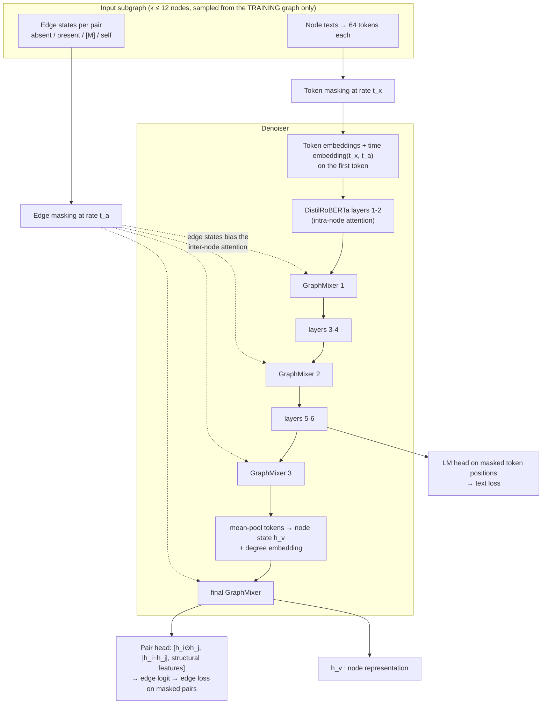
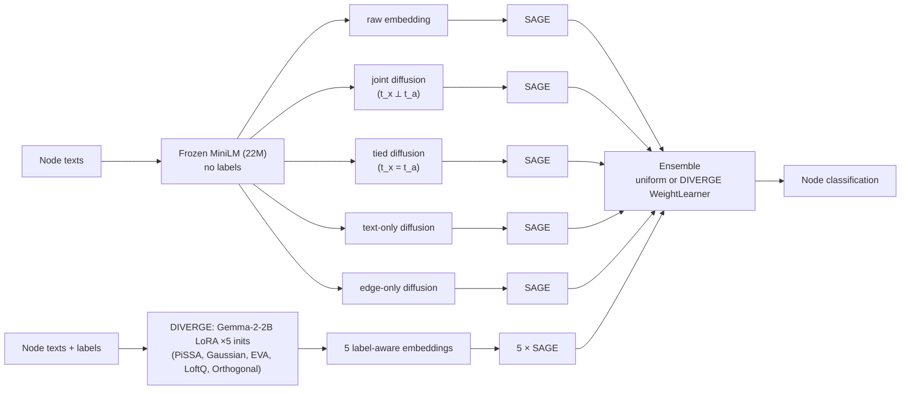

# TwinMask — Joint Masked Diffusion over Text and Topology in Text-Attributed Graphs

> **Status: research prototype, work in progress (last updated 2026-11-16).**
> Phases 0–3 of the plan are implemented and have been run, and the DIVERGE-style ensemble study is complete for Cora and CiteSeer (4 seeds, fair tuning). Phases 1–3 use a single seed. Negative and mixed findings are reported on purpose; see [Limitations](#9-limitations-and-honest-assessment).

---

## 1. TL;DR

A **text-attributed graph (TAG)** gives every node a piece of raw text and links nodes with edges. Almost all existing methods encode the text *once* with a language model and then run a GNN on top; text and structure are never modelled **jointly and generatively**.

**TwinMask** treats both modalities as discrete variables and corrupts them with a *single* absorbing-state (mask) diffusion process:

* every **text token** of every node can become `[MASK]`;
* every **edge variable** `e_ij ∈ {absent, present}` can become `[MASK]` ("unknown", which is **not** the same as "absent");
* the two modalities get **independent noise levels** `(t_x, t_a) ∈ [0,1]²`.

One denoiser is trained on the whole square, so one model represents all conditionals at once:

| Conditioning `(t_x, t_a)` | What the model computes | Task |
|---|---|---|
| `t_x = 0`, edge masked | `p(A ∣ X, partial A)` | link prediction |
| `t_x = 0`, all of a node's edges masked | `p(edges of v ∣ text)` | cold-start node attachment |
| `t_a = 0`, text masked | `p(X ∣ A, neighbours' text)` | text completion / imputation |
| `t_x = 1` (text fully masked) | `p(A ∣ partial A)` | link prediction with **missing text** |
| `(1, 1) → (0, 0)` | `p(X, A)` | joint TAG generation (planned) |
| `(0, 0)` | node state `h_v` | representation learning |

To my knowledge (literature search, Nov 2026) no published work diffuses **raw node text tokens and edges together with separate noise levels**. Closest work: TAG-DLM (masks only the answer token of a frozen LLaDA-8B), Mao et al. EMNLP 2026 (autoregressive over Eulerian traversals), UTGDiff (molecules; text only as condition), GraphMaker (attribute *vectors*, not text).

**Headline findings so far** (details in §7):

1. **Robust to a missing modality.** Trained with text masking, TwinMask still ranks edges from structure alone (graph-only link-prediction AUC 57–95 across 7 datasets); an edge-only model collapses to chance (42–46 on Cora/CiteSeer).
2. **"Unknown" ≠ "absent" matters.** Treating masked edges as absent (edge-dropout view) lowers graph-only AUC by up to **5 points** on PubMed (86.9 → 81.9) compared with a dedicated `[MASK]` edge state.
3. **Hard-negative link prediction (HeaRT).** On PubMed, token-level TwinMask reaches MRR 18–25 versus 13.6 for plain text similarity and 7.6–8.8 for embedding-level GCN models.
4. **When does neighbourhood text help reconstruct text?** An NELBO-difference estimator (*TSMI*) shows it helps on homophilous graphs (Cora, CiteSeer, PubMed) and **hurts** on low-homophily ones (WikiCS, Instagram, Reddit).
5. **Cheap ensemble diversity (DIVERGE bridge, 4 seeds, fairly tuned).** Four label-free diffusion views plus the raw embedding of a frozen 22M encoder match the 5×2.6B-parameter LoRA ensemble of DIVERGE within noise (Cora 88.65 vs 88.88; CiteSeer 78.25 vs 78.21), and combining both pools gives the best mean on both datasets (Cora 89.58, CiteSeer 79.08; gains of +0.7 / +0.9 points, smaller than the seed std of the baseline).
6. **A claim that did *not* survive:** separate noise levels beat a shared level for text reconstruction at the *embedding* level (Phase 0), but not consistently at the token level (Phase 1). See §9.

---

## 2. Method

### 2.1 Formulation

For a sampled subgraph `S` with `k` nodes:

* node text `s_i = (s_i^1 … s_i^L)`, `L = 64` RoBERTa tokens;
* edge variables `e_ij ∈ {0,1}` for all pairs `i<j` in `S`.

**Forward process** (absorbing state, linear schedule `α(t) = 1 − t`), independent per modality:

```
q(z_token | s)  = α(t_x)·δ_s  + (1 − α(t_x))·δ_[M]        every token, independently
q(z_edge  | e)  = α(t_a)·δ_e  + (1 − α(t_a))·δ_[M]        every pair, independently
(t_x, t_a) ~ U[0,1]²  with small probability mass on the borders t=0 (condition) and t=1 (marginal)
```

A masked edge state means *unknown*. This is what separates the method from edge dropout, where a removed edge is indistinguishable from a non-edge.

**Training objective.** The continuous-time MDLM bound for two modalities is

```
NELBO = E_{t_x,t_a}[ (1/t_x) Σ_{masked tokens} −log p_θ(s | z)  +  λ (1/t_a) Σ_{masked pairs} −log p_θ(e | z) ]
```

For optimisation I use the low-variance form **mean cross-entropy over masked items** (the 1/t weights produced gradient spikes on short sequences and few edge variables); the exact 1/t-weighted NELBO is used for *evaluation*, in particular for TSMI.

### 2.2 Architecture



**GraphMixer (the cross-modal component).** Per-node summaries (mean over the node's tokens) attend to each other with a **per-head additive bias that depends on the *current, partially masked* state of each edge**:

```
bias(i,j,head) = E[state_ij][head],   state ∈ {absent, present, masked, self}
init:  absent = −4,  masked = −2,  present = 0,  self = 0     (GAT-like attention over the visible graph)
```

so every edge that is revealed during denoising immediately changes which neighbours exchange information (**dynamic topology attention**). TAG-DLM uses a *fixed* topology mask. The mixer's update is added back to *every token* of the node, so neighbour information reaches the LM head. Because softmax attention is a weighted mean and cannot count neighbours when inputs coincide (e.g. fully masked text), **degree** and **path-count features** (`log1p(A²)`, `log1p(A³)`, `log1p(deg_i·deg_j)`, computed from *visible* edges only) are given explicitly to the node states and the pair head.

**Backbone.** DistilRoBERTa (82M), encoder weights initialised from `all-distilroberta-v1` (contrastively pre-trained, same tokenizer), MLM head from `distilroberta-base`. Mixed precision (bf16), chunked LM head to keep the 50k-vocab logits small. 6.7 GB peak on a 12 GB RTX 5070.

### 2.3 Variants used in ablations

| Variant | `t_x` | `t_a` | Purpose |
|---|---|---|---|
| `joint` | independent | independent | the proposed model |
| `tied` | = `t_a` | = `t_x` | does a *separate* noise level help? |
| `text_only` | sampled | 0 | no edge supervision (GraphMAE-style) |
| `edge_only` | 0 | sampled | no text corruption (MaskGAE-style) |
| `static` | indep. | indep. | masked edges treated as *absent* in attention |
| `notopo` | indep. | indep. | structure-blind mixer |

### 2.4 Text–Structure Mutual Information (TSMI)

Because one model gives both `p(A|X)` and `p(A)` (set `t_x = 1`), differences of Monte-Carlo NELBO estimates (stratified `t` grid, 10 points) give a diagnostic of *how much one modality tells about the other*:

```
TSMI_A  = [NELBO(A | X masked) − NELBO(A | X)] / #pairs          nats per edge variable   (text → structure)
TSMI_X  = [NELBO(X | A masked) − NELBO(X | A)] / #tokens         nats per token           (edges → text)
CTX_X   = [NELBO(X_v | v alone) − NELBO(X_v | subgraph)] / #tok  nats per token           (neighbourhood text+edges → text)
```

These are differences of *upper bounds* on `−log p`, i.e. estimates, not exact mutual information.

---

## 3. Experimental setup

### 3.1 Data
Seven TAGs with raw text, taken from the graph files of the DIVERGE / LLMNodeBed codebase (`datasets/*.pt`):

| Dataset | Nodes | Edges (undirected) | Classes | Edge homophily | Domain |
|---|---:|---:|---:|---:|---|
| Cora | 2,708 | 5,278 | 7 | 0.810 | citations |
| CiteSeer | 3,186 | 4,225 | 6 | 0.744 | citations |
| PubMed | 19,717 | 44,324 | 3 | 0.802 | citations |
| WikiCS | 11,701 | ~216k | 10 | 0.654 | web links |
| Instagram | 11,339 | ~78k | 2 | 0.586 | social |
| Reddit | 33,434 | ~151k | 2 | 0.588 | social |
| ogbn-arxiv | 169,343 | 1.17M | 40 | 0.654 | citations |

### 3.2 Leak-free link-prediction protocol
* 5 % of nodes are **cold-start nodes**: *all* their edges are removed from training.
* Of the remaining edges: 10 % test, 5 % validation, rest = training graph. Every model, including its subgraph sampler and neighbourhood features, sees **only the training graph**.
* **Random negatives:** AUC / AP. **HeaRT hard negatives** (Li et al., NeurIPS 2023 D&B): for each test positive, 100 negatives from the top-ranked candidates of a mix of Resource-Allocation, Personalized-PageRank and text-cosine, excluding every true edge of the *full* graph. Metrics: MRR, Hits@K. Deviations from the paper: K = 100 (not 500), ≤ 1000 positives per dataset.

### 3.3 Node-classification protocols
Representations are learned **without labels**; labels enter only in the final classifier.
* **Low-label:** public split (Cora 140 / CiteSeer 120 / PubMed 60 labels; WikiCS 5 %; Instagram, Reddit 10 %).
* **Supervised 60/20/20:** random splits, 10 repetitions (linear probe) or DIVERGE's seeds 42–45 (GNN).

### 3.4 Evaluation lessons (documented because they changed conclusions)
* Random-negative AUC saturates (all models 97–99 on Cora/CiteSeer/PubMed); **HeaRT changes the ranking of methods** — on citation graphs plain text cosine beats every trained model.
* A linear probe with fixed `C = 1` underestimated Phase 0 by up to 5 points (CiteSeer 68.5 → 73.4 when tuned on validation); using the link-prediction graph (77 % of edges) for classification cost another 0.5–2 points.
* A training-free baseline (MiniLM + 2-step SGC propagation) already reaches 82.2 on Cora; any NC claim must be compared against it. A supervised GCN on our features (82.46) reproduces GLBench's published GCN (82.11), confirming that the data pipeline is sound.

---

## 4. Phases

| Phase | Content | Status |
|---|---|---|
| **0** | Embedding-level version of the original idea: Gaussian diffusion on MiniLM embeddings + masked edges, GCN denoiser, 6 variants × 6 datasets × 3 seeds, HeaRT | ✅ done |
| **1** | Token-level TwinMask (DistilRoBERTa), Cora/CiteSeer/PubMed × 4 variants | ✅ done (1 seed) |
| **2** | Topology ablations, (t_x, t_a) heatmaps, TSMI on 6 datasets | ✅ done |
| **3** | Scale to ogbn-arxiv (169k nodes) | ✅ done (joint, edge_only) |
| **Bridge** | DIVERGE-style view ensembles with diffusion views, fair tuning | ✅ done for Cora and CiteSeer (4 seeds) |
| 4 | TAG generation (joint sampling), comparison with Mao et al. / GraphMaker | ⏳ planned |

---

## 5. How the work relates to DIVERGE (view-ensemble bridge)

DIVERGE (my earlier work, the codebase this project draws data and tooling from) fine-tunes an LLM five times with different LoRA initialisations *using labels*, trains one GNN per resulting embedding, and ensembles them. Its diversity source is the **fine-tuning trajectory**. The bridge asks whether **diffusion noise schedules** can supply diversity instead — without fine-tuning any LLM:



Reused directly from DIVERGE: `GNNEncoder`, its 60/20/20 splitter and seeds (42–45), its tuned GNN configs, its `WeightLearner` ensemble head and search grid, and its cached fine-tuned embeddings.

**"Label-free" means:** the *representation* (MiniLM + diffusion) never sees class labels; labels are used only to train the SAGE heads and ensemble weights, exactly as in DIVERGE. DIVERGE additionally injects labels into the text encoder via LoRA fine-tuning.

---

## 6. Repository layout

```
twinmask/
  data.py          dataset extraction from DIVERGE, leak-free link splits, cold-start nodes, MiniLM + RoBERTa-token caches
  heart.py         HeaRT hard-negative construction (RA + PPR + text-cosine) and MRR / Hits@K
  phase0.py        embedding-level joint diffusion (Gaussian text + masked edges, GCN denoiser), all variants
  model.py         TwinMask: DistilRoBERTa + GraphMixer (dynamic topology attention) + token/edge heads
  sampler.py       subgraph sampler over the TRAINING graph, forced-mask pairs, cold-start masking
  tm.py            token-level corruption, losses, training loop with validation-AUC checkpoint selection, evaluation
  phase2.py        (t_x, t_a) heatmaps, NELBO estimators, TSMI / CTX_X
  common.py        time embedding, noise-level sampler, metrics, two-setting NC probe
  report.py        aggregates results/*.json into results/REPORT.md and figures
scripts/
  calibrate.py, calibrate_tm.py   controlled checks of where NC gaps to published numbers come from
  diverge_bridge.py               untuned DIVERGE x diffusion-view ensembles
  tune_bridge.py                  fair tuning: diffusion grid, per-view SAGE search, learned ensembles
  diag_lp.py, smoke_test.py, reeval.py
run_all.py         job queue for phases 1-3
research_proposal.md   original literature review and research plan (Persian)
```

---

## 7. Results

All numbers are percentages unless stated. "±" is the standard deviation over seeds where more than one seed was run.

### 7.1 Phase 0 — embedding level (MiniLM + GCN denoiser; 3 seeds)

**Does the graph help reconstruct a heavily noised text embedding?** Cosine gain (graph visible − graph hidden) at noise level `t = 0.9`:

| Dataset | `text_only` | **`joint`** | `tied` |
|---|---:|---:|---:|
| Cora | +0.146 | **+0.089** | +0.039 |
| CiteSeer | +0.116 | **+0.081** | +0.045 |
| PubMed | +0.039 | **+0.032** | +0.016 |
| WikiCS | +0.139 | **+0.118** | +0.051 |
| Instagram | +0.023 | **+0.021** | +0.010 |
| Reddit | +0.047 | **+0.042** | +0.016 |

Independent noise levels (`joint`) make the model exploit the graph **2–3× more than a shared level** (`tied`), on all six datasets. At `t = 0.5` the gain is ≈ 0 (the text alone suffices).

**Link prediction, random vs. hard negatives (MRR, HeaRT):**

| | Text cosine | GAE | Edge-only | Tied | Joint |
|---|---:|---:|---:|---:|---:|
| Cora | **20.6** | 16.7 | 15.7 | 13.7 | 14.5 |
| PubMed | **13.6** | 7.6 | 8.3 | 8.8 | 7.7 |
| WikiCS | 8.1 | **23.0** | 18.7 | 15.6 | 19.1 |
| Reddit | 3.1 | 3.3 | 3.4 | 3.7 | **3.9** |

With random negatives every trained model scores AUC 97–99 on the citation graphs, which hides these differences.

### 7.2 Phase 1 — token-level TwinMask (1 seed, DistilRoBERTa; 2000 steps, checkpoint selected on validation AUC)

| Dataset | Model | LP AUC | **Graph-only LP AUC** (text masked) | HeaRT MRR | Cold-start AUC | NC 60/20/20 |
|---|---|---:|---:|---:|---:|---:|
| Cora | edge-only | 85.0 | 42.5 | **16.0** | **83.6** | 73.5 |
| | tied | 89.5 | **67.0** | 15.8 | 81.5 | 80.4 |
| | **joint** | **89.8** | 64.5 | 14.7 | 83.0 | 79.9 |
| CiteSeer | edge-only | 89.2 | 45.6 | **24.7** | **89.6** | 64.9 |
| | tied | **90.2** | **61.3** | 15.0 | 85.0 | 67.1 |
| | **joint** | 90.0 | 57.4 | 16.3 | 89.5 | 67.5 |
| PubMed | edge-only | **97.3** | 78.4 | **24.6** | **90.6** | 88.3 |
| | tied | 96.6 | **88.7** | 20.8 | 87.6 | 87.7 |
| | **joint** | 96.5 | 86.9 | 18.4 | 89.4 | 88.1 |

Other datasets (joint only): WikiCS LP 97.5 / graph-only 95.1 / HeaRT MRR 25.3; Instagram 90.7 / 85.3 / 8.8; Reddit 77.6 / 69.9 / 3.5. **ogbn-arxiv (169k nodes, 8000 steps):** joint LP 98.1, graph-only 88.4 (edge-only: 73.1), HeaRT MRR 7.5, text-completion NLL 3.65 with context vs. 3.76 alone.

**Reading the table:**
* Training with text masking is what makes the model usable when **text is missing** (graph-only AUC 57–95 vs. 42–78 for edge-only). The price is some ranking precision when text is available (edge-only wins HeaRT/cold-start on all three datasets).
* On the largest citation graph here (PubMed), HeaRT MRR (18–25) is well above plain text similarity (13.6) and embedding-level GNNs (≤ 8.8). On the two smaller graphs TwinMask is *not* better than text similarity.
* `joint` is **not** consistently better than `tied` at the token level.

### 7.3 Phase 2 — does the dynamic topology matter? (1 seed)

| | Graph-only LP, Cora | Graph-only LP, PubMed | HeaRT MRR, PubMed |
|---|---:|---:|---:|
| **Dynamic** (`[M]` is its own state) | **64.5** | **86.9** | 18.4 |
| Static (`[M]` treated as absent) | 63.4 | 81.9 | **22.7** |
| No topology | 61.3 | 79.7 | 20.4 |

Distinguishing *unknown* from *absent* helps when edges are scarce (graph-only), but the static variant ranks hard negatives better on PubMed. Node classification is unaffected (79.6–79.9 / 88.0–88.1).

### 7.4 Phase 2 — TSMI across datasets

| Dataset | Edge homophily | TSMI_A (text → edges) | TSMI_X (edges → text) | **CTX_X** (neighbourhood → text) |
|---|---:|---:|---:|---:|
| Cora | 0.810 | 0.139 | 0.023 | **+0.066** |
| PubMed | 0.802 | 0.043 | −0.002 | **+0.022** |
| CiteSeer | 0.744 | 0.103 | 0.008 | **+0.017** |
| WikiCS | 0.654 | 0.131 | −0.003 | −0.009 |
| Reddit | 0.588 | 0.020 | −0.001 | **−0.020** |
| Instagram | 0.586 | 0.007 | −0.004 | **−0.024** |

(nats per item.) **`CTX_X` is positive on the three homophilous graphs and negative on the three low-homophily ones**: giving a node its neighbours' text *helps* reconstruct its own text when neighbours are similar and *hurts* when they are not. `TSMI_A` does not track homophily monotonically (WikiCS is high), so homophily alone does not explain text→structure information. Estimates come from one trained model per dataset and 256 subgraphs; they are not yet accompanied by confidence intervals.

The `(t_x, t_a)` heatmaps (edge AUC and text NLL over the 5×5 noise grid, one model) are written to `results/fig_heatmap_*.png`.

### 7.5 Bridge — DIVERGE-style ensembles (60/20/20, seeds 42–45)

**Untuned diffusion views** (DIVERGE's SAGE config reused as is), 4 seeds:

| | Cora | CiteSeer |
|---|---:|---:|
| MiniLM + SAGE | 86.90 ± 0.89 | 76.57 ± 2.08 |
| One DIVERGE view (Gemma-2-2B LoRA, best init) | 88.84 | 77.55 |
| **DIVERGE ensemble (5 LoRA inits)** | **88.88 ± 1.40** | **78.21 ± 1.64** |
| **MiniLM + 4 diffusion views** (no LLM fine-tuning) | 88.65 ± 0.62 | 77.43 ± 1.89 |
| DIVERGE-5 + diffusion views | 88.47 | 78.06 |

**Fairly tuned, 4 seeds** — all selection on validation only: the diffusion model's hyper-parameters are grid-searched per variant (hidden size, epochs, edge-loss weight, boundary probability; 16 configs) on the seed-42 split and then frozen; SAGE is searched per view and per seed with DIVERGE's search space (64 random candidates, top 6 re-run with 3 GNN seeds); the learned ensemble is DIVERGE's own `WeightLearner` with its grid. DIVERGE's Gemma views keep DIVERGE's own tuned configs.

| Test accuracy (%, mean ± std over seeds 42–45) | Cora | CiteSeer |
|---|---:|---:|
| MiniLM + SAGE (single view, tuned) | 87.68 ± 0.48 | 76.96 ± 1.52 |
| best single diffusion view (tuned; Cora: text-only, CiteSeer: joint) | 88.24 ± 0.46 | 77.08 ± 1.67 |
| best single DIVERGE view (Gemma-2-2B LoRA, best init) | 88.84 ± 1.20 | 77.55 ± 1.54 |
| **DIVERGE-5, uniform** | **88.88 ± 1.40** | 78.21 ± 1.64 |
| DIVERGE-5, learned head | 88.70 ± 1.29 | 78.10 ± 2.03 |
| **MiniLM + 4 diffusion views, uniform** (no LLM fine-tuning) | 88.65 ± 0.71 | **78.25 ± 1.17** |
| MiniLM + 4 diffusion views, learned head | 88.47 ± 0.66 | 78.06 ± 1.20 |
| **DIVERGE-5 + our 5 views, learned head** | **89.58 ± 0.55** | **79.08 ± 1.68** |

What the data support:
* A **single** diffusion view is only marginally better than the raw encoder (≤ 0.6 points, inside the noise). The benefit appears when views are **combined**: four diffusion views plus the raw embedding reach the level of the five-LoRA DIVERGE ensemble, with minutes of training instead of five fine-tunings of a 2.6B model.
* Per-seed, the combined pool is at least as good as DIVERGE-5 with the learned head on 3 of 4 seeds on both datasets (Cora seed 45: −0.2); against DIVERGE-5 with uniform averaging it wins on 2 of 4 seeds on Cora and 3 of 4 on CiteSeer. The mean gains (+0.7, +0.9) are **smaller than the baseline's seed-to-seed std (1.4–1.6)**, so this is evidence of complementarity, not of a significant improvement.
* **Tuning did not change the conclusion.** Re-tuning SAGE for our views moved single-view accuracy by −0.5 to +0.8 points, with no consistent direction; the untuned comparison reported earlier (Cora 88.65 vs 88.88, CiteSeer 77.43 vs 78.21) was not biased in a way that mattered.
* My reproduction of DIVERGE (Gemma-2-2B only, plain or head-weighted averaging) is about 1 point below the numbers in the DIVERGE paper (89.9 / 79.5), which uses additional design choices not replicated here.
* Not yet tested: PubMed, WikiCS, ogbn-arxiv; learned ensembles on more than 4 seeds; significance tests.

---

### 7.6 Bridge 2 — DIVERGE semi-supervised augmentation (public low-label split)

`scripts/semi_aug_bridge.py` re-uses DIVERGE's `tags_data_augmentation` pipeline (Llama-3.2-1B LoRA adapters trained on the 140 / 120 public labels; generated nodes added as pseudo-labelled training nodes with DIVERGE's own validation-selected edge rule, pseudo-label handling, lambda and tuned GNN hyper-parameters = `ref_selected`). Our label-free diffusion views are trained on the same LLM embeddings over the same (augmented) graph: 4 variants on PiSSA + `joint` on the other 4 inits = 8 views. Test accuracy %, mean ± std over 3 GNN repeats, uniform softmax ensembles.

| | Cora base | Cora + aug | CiteSeer base | CiteSeer + aug |
|---|---|---|---|---|
| DIVERGE-1 (5 LoRA inits) | 84.48 ± 0.51 | 84.75 ± 0.44 | 71.60 ± 0.68 | 73.92 ± 0.10 |
| 8 diffusion views only | 82.79 ± 0.32 | 85.09 ± 0.29 | 71.55 ± 0.28 | 73.68 ± 0.02 |
| DIVERGE-1 + diffusion views | 83.67 ± 0.19 | **85.49 ± 0.34** | 71.93 ± 0.19 | **74.08 ± 0.14** |

Reading: (i) the reproduction matches DIVERGE's published numbers (84.8 / 85.0 on Cora) within ~0.3; (ii) without augmentation diffusion views do *not* help on Cora (-0.8); (iii) with augmented nodes the diffusion views are as good as or better than the LoRA members and the combined pool is best (+0.7 Cora, +0.2 CiteSeer over DIVERGE + aug) -- the label-free views seem to be more robust to noisy pseudo-labelled nodes/edges; (iv) all gaps are about one seed-std, only 3 repeats and one LoRA seed, so this is suggestive, not significant. A first run with naive kNN edges and no lambda (not DIVERGE's selected config) collapsed DIVERGE to 73% while diffusion views stayed at 77.8% -- an unfair baseline, discarded. Validation-screened ensembles did not help.

## 8. Reproducing

```bash
# environment: Python 3.13, PyTorch 2.7 (CUDA 12.8), PyG 2.8, transformers 4.55, sentence-transformers 5.1
# 0. point twinmask/data.py:DIVERGE_DIR at a folder with the DIVERGE / LLMNodeBed graph files (cora.pt, ...)
python -m twinmask.data --datasets cora citeseer pubmed wikics instagram reddit arxiv   # splits + MiniLM + tokens
python -m twinmask.heart                                  # HeaRT hard negatives
python -m twinmask.phase0 --epochs 1000                   # Phase 0 (all datasets/variants/seeds)
python run_all.py                                         # Phases 1-3 (several GPU-hours on one 12 GB card)
python -m twinmask.report                                 # -> results/REPORT.md + figures
python scripts/tune_bridge.py cora citeseer               # bridge with fair tuning (~2 GPU-hours for both datasets)
```
`all-distilroberta-v1` weights are expected under `hf_models/all-distilroberta-v1/` (or set `TWINMASK_ENCODER=none` to use the plain MLM encoder).

Hardware used: one RTX 5070 (12 GB). All stages were run with fixed seeds; raw per-run JSON files are in `results/`.

---

## 9. Limitations and honest assessment

* **The central hypothesis is only partly supported.** Independent noise levels beat a shared level for *embedding-level* text denoising (6/6 datasets), but at the token level `joint` ≈ `tied`. Possible causes (untested): early stopping on link-prediction AUC leaves the text side under-trained on small graphs; 82M parameters memorise 3k-node graphs.
* **TwinMask is not a state-of-the-art classifier.** On Cora and CiteSeer it is weaker than our own embedding-level model and than a training-free MiniLM + SGC baseline; neighbour information is not absorbed into the node state the way a GCN does it (adding 2-step propagation to its representations adds ~9 points on Cora). On ogbn-arxiv, NC (≈ 62–66 with a linear probe on a 20k-node subsample) is far below published supervised numbers.
* **Compared with SOTA TAG methods the setting differs:** they fine-tune LLMs (up to 8B) with labels; this project uses an 82M label-free backbone and a lightweight head. I do not claim to beat them.
* **Single seed** in Phase 1–3, no confidence intervals for TSMI, 64-token text truncation (keeps ~50 % of a Cora abstract, ~20 % of a PubMed abstract; measured effect on a frozen encoder: 0.3–2 points).
* **Model-selection hygiene:** during the architectural debugging of TwinMask on Cora I looked at test metrics as well as validation metrics when choosing among model variants. The reported Phase-1 numbers use validation-based checkpoint selection, but those design decisions should be re-verified on validation only before publication. The bridge tuning (Stage A/B) selects on validation only.
* **Not yet done:** joint TAG generation (the main justification for a *generative* joint model), comparison against LLaDA-8B-based TAG-DLM (does not fit on a 12 GB GPU), larger/pre-trained diffusion backbones.
* **Novelty claim** ("first joint masked diffusion over raw node text and edges") is based on a literature search in Nov 2026 and must be re-checked before submission; the area moves quickly.

## 10. Roadmap

1. Extend the bridge study to PubMed / WikiCS / ogbn-arxiv (where Phase 0 was strongest) with more seeds and paired significance tests.
2. Token-level model with DIVERGE's recipe — LoRA instead of full fine-tuning, 512 tokens, explicit propagation in the readout, checkpoint selection on a combined text+edge criterion — to address memorisation and the classification gap.
3. **Label as a third modality** in the same diffusion (text + edges + label): classification becomes denoising of the label variable, putting supervision inside the model.
4. TAG generation with confidence-ordered unmasking over both modalities; evaluation against Mao et al. and GraphMaker; multi-seed runs and TSMI confidence intervals.

## 11. Related work

* Masked diffusion language models: D3PM (Austin et al., 2021), SEDD (Lou et al., 2024), MDLM (Sahoo et al., 2024), LLaDA (Nie et al., 2025).
* Per-modality noise levels / multimodal diffusion: UniDiffuser (Bao et al., 2023), UniDisc (Swerdlow et al., 2025).
* Diffusion for graphs: GDSS, DiGress, EDGE, GraphMaker (Li et al.), DDM (Yang et al., 2023), Graffe (2025).
* Masked graph autoencoders: GraphMAE (Hou et al., 2022), MaskGAE (Li et al., 2023).
* LMs on TAGs: TAPE (He et al., 2024), GLEM, LLaGA, **TAG-DLM** (Chen et al., 2026), Mao et al. (EMNLP 2026), UTGDiff (2024).
* Evaluation: HeaRT (Li et al., NeurIPS 2023 D&B), GLBench (Li et al., NeurIPS 2024).
* DIVERGE: diverse LoRA initialisations + learned GNN ensembles for TAGs (my prior work).

## 12. Contact

*Author:* `<your name>` — `<affiliation / email / webpage>`
