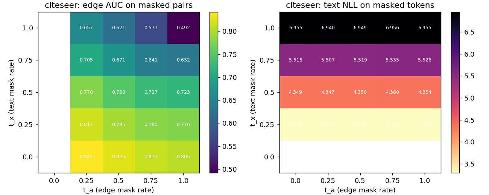
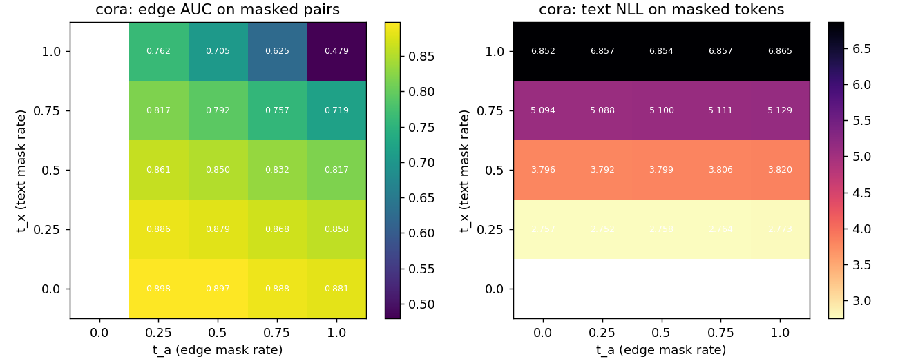
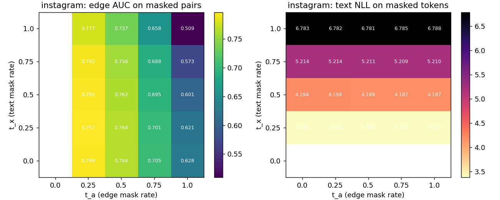
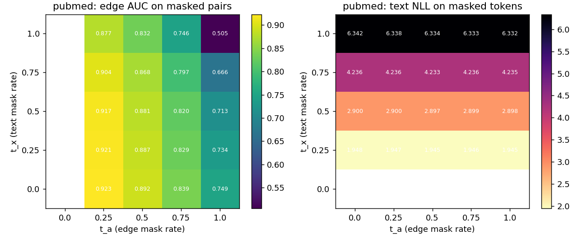
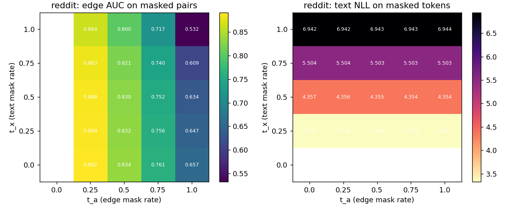
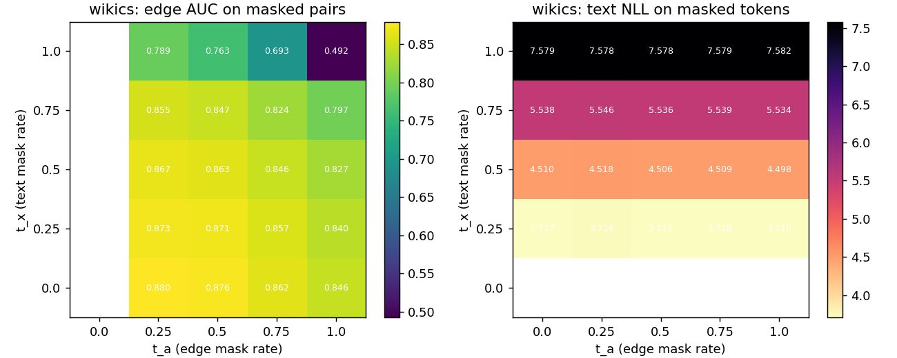
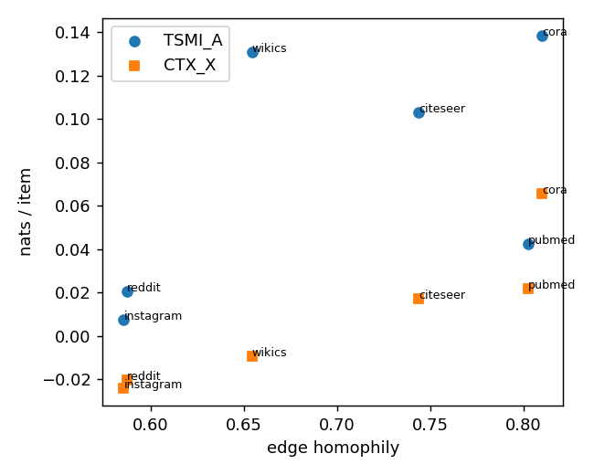

# TwinMask — experimental results (auto-generated)

### Phase 0 — Link prediction (random negatives: AUC; HeaRT hard negatives: MRR, Hits@20), cold-start AUC, node classification (low-label public split / supervised 60-20-20); all in %, mean ± std over seeds

| dataset | variant | LP AUC | HeaRT MRR | HeaRT H@20 | cold AUC | NC low-label | NC 60/20/20 |
|---|---|---|---|---|---|---|---|
| cora | text_cosine | 92.77 ± 0.00 | 20.59 ± 0.00 | 49.47 ± 0.00 | 92.41 ± 0.00 | 72.68 ± 0.00 | 79.00 ± 0.00 |
| cora | gae | 96.85 ± 0.26 | 16.72 ± 0.19 | 55.23 ± 0.72 | 94.14 ± 0.20 | 73.82 ± 0.63 | 83.11 ± 0.48 |
| cora | mlp_lp | 96.48 ± 0.19 | 17.26 ± 0.20 | 57.19 ± 0.95 | 95.46 ± 0.32 | 76.48 ± 0.88 | 82.97 ± 0.26 |
| cora | edge_only | 97.18 ± 0.21 | 15.70 ± 1.30 | 55.16 ± 2.36 | 95.28 ± 0.14 | 77.03 ± 1.55 | 83.59 ± 0.58 |
| cora | text_only | – | – | – | – | 77.13 ± 0.55 | 85.18 ± 0.07 |
| cora | tied | 97.16 ± 0.28 | 13.74 ± 1.82 | 55.23 ± 2.16 | 95.24 ± 0.45 | 76.79 ± 0.69 | 84.59 ± 0.22 |
| cora | joint | 97.19 ± 0.05 | 14.50 ± 0.57 | 58.81 ± 0.36 | 95.10 ± 0.27 | 77.56 ± 1.06 | 84.92 ± 0.60 |
| citeseer | text_cosine | 96.07 ± 0.00 | 29.57 ± 0.00 | 61.07 ± 0.00 | 95.26 ± 0.00 | 68.67 ± 0.00 | 66.29 ± 0.00 |
| citeseer | gae | 97.95 ± 0.14 | 27.74 ± 0.55 | 69.69 ± 0.70 | 96.10 ± 0.22 | 63.60 ± 0.99 | 67.61 ± 0.17 |
| citeseer | mlp_lp | 98.24 ± 0.12 | 27.82 ± 0.49 | 70.31 ± 0.63 | 97.10 ± 0.20 | 67.29 ± 0.35 | 68.09 ± 0.28 |
| citeseer | edge_only | 98.30 ± 0.22 | 27.76 ± 1.27 | 70.93 ± 0.58 | 96.75 ± 0.04 | 67.17 ± 0.27 | 68.24 ± 0.38 |
| citeseer | text_only | – | – | – | – | 68.08 ± 0.33 | 69.78 ± 0.68 |
| citeseer | tied | 98.64 ± 0.04 | 24.92 ± 1.51 | 70.76 ± 0.82 | 97.21 ± 0.09 | 68.17 ± 0.13 | 71.59 ± 0.28 |
| citeseer | joint | 98.60 ± 0.06 | 24.18 ± 0.65 | 70.22 ± 1.45 | 97.10 ± 0.11 | 67.61 ± 0.46 | 70.39 ± 0.47 |
| pubmed | text_cosine | 95.10 ± 0.00 | 13.58 ± 0.00 | 35.70 ± 0.00 | 95.27 ± 0.00 | 75.75 ± 0.00 | 88.01 ± 0.00 |
| pubmed | gae | 98.87 ± 0.05 | 7.63 ± 0.50 | 36.13 ± 1.27 | 97.15 ± 0.09 | 79.92 ± 0.17 | 88.09 ± 0.12 |
| pubmed | mlp_lp | 97.92 ± 0.05 | 5.82 ± 0.32 | 27.83 ± 0.74 | 97.58 ± 0.07 | 80.18 ± 0.44 | 88.40 ± 0.09 |
| pubmed | edge_only | 99.06 ± 0.03 | 8.32 ± 0.31 | 37.37 ± 1.06 | 97.63 ± 0.05 | 80.54 ± 0.21 | 88.55 ± 0.09 |
| pubmed | text_only | – | – | – | – | 75.69 ± 1.62 | 88.33 ± 0.14 |
| pubmed | tied | 99.14 ± 0.08 | 8.80 ± 0.93 | 40.00 ± 2.98 | 97.64 ± 0.07 | 81.11 ± 0.44 | 88.95 ± 0.09 |
| pubmed | joint | 99.22 ± 0.02 | 7.66 ± 0.52 | 38.43 ± 1.27 | 97.62 ± 0.13 | 81.82 ± 0.65 | 89.06 ± 0.12 |
| wikics | text_cosine | 88.58 ± 0.00 | 8.14 ± 0.00 | 19.30 ± 0.00 | 87.43 ± 0.00 | 69.83 ± 0.00 | 73.43 ± 0.00 |
| wikics | gae | 99.22 ± 0.01 | 23.01 ± 0.90 | 55.13 ± 1.42 | 95.38 ± 0.42 | 72.05 ± 0.63 | 78.75 ± 0.03 |
| wikics | mlp_lp | 96.08 ± 0.42 | 10.34 ± 3.72 | 34.83 ± 7.21 | 95.45 ± 0.74 | 74.91 ± 0.21 | 78.79 ± 0.38 |
| wikics | edge_only | 99.25 ± 0.01 | 18.72 ± 2.69 | 52.23 ± 0.66 | 96.89 ± 0.07 | 73.37 ± 0.31 | 78.89 ± 0.16 |
| wikics | text_only | – | – | – | – | 77.33 ± 0.38 | 80.94 ± 0.28 |
| wikics | tied | 99.15 ± 0.02 | 15.58 ± 0.27 | 46.93 ± 0.34 | 96.58 ± 0.06 | 75.81 ± 0.24 | 81.09 ± 0.19 |
| wikics | joint | 99.14 ± 0.00 | 19.10 ± 1.06 | 52.23 ± 0.76 | 96.91 ± 0.05 | 76.92 ± 0.31 | 81.14 ± 0.32 |
| instagram | text_cosine | 73.70 ± 0.00 | 2.99 ± 0.00 | 6.20 ± 0.00 | 71.18 ± 0.00 | 58.17 ± 0.00 | 64.81 ± 0.00 |
| instagram | gae | 96.33 ± 0.04 | 7.64 ± 0.46 | 31.87 ± 0.57 | 84.32 ± 0.28 | 61.06 ± 0.33 | 66.24 ± 0.27 |
| instagram | mlp_lp | 94.31 ± 0.07 | 3.23 ± 0.05 | 12.83 ± 0.40 | 84.29 ± 0.37 | 60.81 ± 0.57 | 66.31 ± 0.38 |
| instagram | edge_only | 96.80 ± 0.07 | 6.15 ± 0.73 | 26.20 ± 2.41 | 86.04 ± 0.13 | 61.43 ± 0.32 | 66.44 ± 0.07 |
| instagram | text_only | – | – | – | – | 60.86 ± 0.56 | 66.61 ± 0.09 |
| instagram | tied | 96.95 ± 0.04 | 7.14 ± 0.34 | 29.63 ± 0.58 | 86.70 ± 0.16 | 61.61 ± 0.12 | 66.49 ± 0.12 |
| instagram | joint | 97.00 ± 0.02 | 6.70 ± 0.48 | 29.33 ± 1.02 | 87.32 ± 0.17 | 61.37 ± 0.59 | 66.67 ± 0.22 |
| reddit | text_cosine | 69.92 ± 0.00 | 3.09 ± 0.00 | 6.50 ± 0.00 | 70.22 ± 0.00 | 56.86 ± 0.00 | 60.18 ± 0.00 |
| reddit | gae | 88.30 ± 0.02 | 3.29 ± 0.12 | 13.20 ± 0.33 | 80.15 ± 0.36 | 65.82 ± 0.14 | 68.21 ± 0.27 |
| reddit | mlp_lp | 86.83 ± 0.13 | 3.16 ± 0.10 | 10.20 ± 0.43 | 80.73 ± 0.38 | 64.33 ± 0.78 | 66.63 ± 0.42 |
| reddit | edge_only | 90.74 ± 0.07 | 3.44 ± 0.11 | 12.30 ± 0.16 | 83.47 ± 0.17 | 65.72 ± 0.07 | 68.01 ± 0.03 |
| reddit | text_only | – | – | – | – | 65.39 ± 0.14 | 67.59 ± 0.20 |
| reddit | tied | 91.57 ± 0.02 | 3.72 ± 0.07 | 15.80 ± 0.22 | 83.87 ± 0.17 | 66.10 ± 0.13 | 68.24 ± 0.11 |
| reddit | joint | 91.84 ± 0.07 | 3.89 ± 0.12 | 16.57 ± 0.95 | 83.86 ± 0.14 | 66.21 ± 0.08 | 68.24 ± 0.16 |

### Phase 0 — Text-embedding denoising: cosine(x̂0, x0) of test nodes, graph visible vs hidden

| dataset | variant | t | noisy input | no graph | with graph | Δ (graph − no graph) |
|---|---|---|---|---|---|---|
| cora | text_only | 0.5 | 0.763 | 0.830 | 0.848 | +0.018 |
| cora | text_only | 0.9 | 0.315 | 0.496 | 0.642 | +0.146 |
| cora | joint | 0.5 | 0.763 | 0.838 | 0.841 | +0.003 |
| cora | joint | 0.9 | 0.315 | 0.512 | 0.601 | +0.089 |
| cora | tied | 0.5 | 0.763 | 0.827 | 0.829 | +0.002 |
| cora | tied | 0.9 | 0.315 | 0.505 | 0.544 | +0.039 |
| citeseer | text_only | 0.5 | 0.760 | 0.845 | 0.853 | +0.008 |
| citeseer | text_only | 0.9 | 0.307 | 0.522 | 0.638 | +0.116 |
| citeseer | joint | 0.5 | 0.760 | 0.841 | 0.842 | +0.001 |
| citeseer | joint | 0.9 | 0.307 | 0.526 | 0.607 | +0.081 |
| citeseer | tied | 0.5 | 0.760 | 0.832 | 0.833 | +0.001 |
| citeseer | tied | 0.9 | 0.307 | 0.511 | 0.556 | +0.045 |
| pubmed | text_only | 0.5 | 0.812 | 0.895 | 0.895 | +0.000 |
| pubmed | text_only | 0.9 | 0.457 | 0.665 | 0.704 | +0.039 |
| pubmed | joint | 0.5 | 0.812 | 0.882 | 0.883 | +0.000 |
| pubmed | joint | 0.9 | 0.457 | 0.664 | 0.697 | +0.032 |
| pubmed | tied | 0.5 | 0.812 | 0.870 | 0.870 | +0.001 |
| pubmed | tied | 0.9 | 0.457 | 0.653 | 0.669 | +0.016 |
| wikics | text_only | 0.5 | 0.769 | 0.840 | 0.848 | +0.008 |
| wikics | text_only | 0.9 | 0.334 | 0.508 | 0.647 | +0.139 |
| wikics | joint | 0.5 | 0.769 | 0.835 | 0.839 | +0.004 |
| wikics | joint | 0.9 | 0.334 | 0.509 | 0.627 | +0.118 |
| wikics | tied | 0.5 | 0.769 | 0.824 | 0.827 | +0.003 |
| wikics | tied | 0.9 | 0.334 | 0.509 | 0.559 | +0.051 |
| instagram | text_only | 0.5 | 0.775 | 0.858 | 0.859 | +0.001 |
| instagram | text_only | 0.9 | 0.352 | 0.543 | 0.566 | +0.023 |
| instagram | joint | 0.5 | 0.775 | 0.843 | 0.845 | +0.001 |
| instagram | joint | 0.9 | 0.352 | 0.539 | 0.560 | +0.021 |
| instagram | tied | 0.5 | 0.775 | 0.833 | 0.835 | +0.002 |
| instagram | tied | 0.9 | 0.352 | 0.531 | 0.542 | +0.010 |
| reddit | text_only | 0.5 | 0.724 | 0.807 | 0.807 | -0.001 |
| reddit | text_only | 0.9 | 0.204 | 0.326 | 0.374 | +0.047 |
| reddit | joint | 0.5 | 0.724 | 0.794 | 0.795 | +0.001 |
| reddit | joint | 0.9 | 0.204 | 0.323 | 0.365 | +0.042 |
| reddit | tied | 0.5 | 0.724 | 0.782 | 0.783 | +0.001 |
| reddit | tied | 0.9 | 0.204 | 0.311 | 0.327 | +0.016 |

### Phase 1/2 (TwinMask-S, DistilRoBERTa backbone) — link prediction / cold-start / node classification

| dataset | variant | seed | LP AUC (full) | LP AUC text masked | LP AUC pair only | HeaRT MRR | HeaRT H@20 | cold AUC | NC low-label | NC 60/20/20 |
|---|---|---|---|---|---|---|---|---|---|---|
| citeseer | edge_only | 0 | 89.18 | 45.64 | 88.56 | 24.69 | 60.80 | 89.59 | 61.15 | 64.92 |
| citeseer | joint | 0 | 89.98 | 57.44 | 87.90 | 16.26 | 53.60 | 89.53 | 67.26 | 67.48 |
| citeseer | text_only | 0 | – | – | – | – | – | – | 65.78 | 67.07 |
| citeseer | tied | 0 | 90.23 | 61.30 | 86.80 | 15.02 | 57.60 | 85.02 | 64.61 | 67.12 |
| cora | edge_only | 0 | 84.98 | 42.47 | 84.52 | 15.97 | 47.79 | 83.64 | 59.91 | 73.54 |
| cora | joint | 0 | 89.79 | 64.51 | 89.28 | 14.69 | 47.16 | 82.97 | 69.87 | 79.89 |
| cora | joint | 1 | 89.39 | 63.35 | 87.99 | 13.18 | 44.63 | 82.00 | 70.55 | 79.11 |
| cora | notopo | 0 | 86.81 | 61.33 | 86.47 | 13.27 | 45.47 | 84.57 | 69.15 | 79.67 |
| cora | static | 0 | 89.76 | 63.44 | 88.33 | 14.81 | 46.95 | 85.36 | 70.84 | 79.58 |
| cora | text_only | 0 | – | – | – | – | – | – | 70.60 | 80.90 |
| cora | tied | 0 | 89.54 | 67.02 | 84.60 | 15.82 | 52.63 | 81.47 | 73.02 | 80.42 |
| instagram | joint | 0 | 90.72 | 85.28 | 77.55 | 8.78 | 26.30 | 77.22 | 58.47 | 64.18 |
| pubmed | edge_only | 0 | 97.25 | 78.44 | 96.65 | 24.60 | 58.60 | 90.64 | 75.67 | 88.33 |
| pubmed | joint | 0 | 96.51 | 86.87 | 93.82 | 18.36 | 49.20 | 89.40 | 76.35 | 88.09 |
| pubmed | notopo | 0 | 95.63 | 79.73 | 93.58 | 20.40 | 55.50 | 90.31 | 75.36 | 88.05 |
| pubmed | static | 0 | 96.37 | 81.91 | 93.73 | 22.69 | 56.20 | 90.61 | 76.66 | 87.96 |
| pubmed | text_only | 0 | – | – | – | – | – | – | 76.66 | 87.39 |
| pubmed | tied | 0 | 96.62 | 88.72 | 90.54 | 20.83 | 52.10 | 87.58 | 75.96 | 87.67 |
| reddit | joint | 0 | 77.58 | 69.92 | 74.39 | 3.48 | 13.00 | 67.53 | 63.95 | 67.73 |
| wikics | joint | 0 | 97.47 | 95.12 | 93.50 | 25.34 | 54.90 | 94.95 | 77.49 | 79.63 |

### Phase 1/2 (TwinMask-S, DistilRoBERTa backbone) — text completion of a test node (masked-token NLL ↓ / top-1 acc ↑)

| dataset | variant | mask ratio | alone | subgraph, edges [M] | subgraph + edges | NLL gain of context |
|---|---|---|---|---|---|---|
| citeseer | joint | 0.5 | 4.741 / 24.2% | 4.611 / 25.5% | 4.615 / 25.4% | +0.126 |
| citeseer | joint | 1.0 | 7.137 / 4.8% | 7.045 / 4.9% | 7.039 / 4.9% | +0.099 |
| citeseer | text_only | 0.5 | 3.825 / 32.8% | 3.563 / 35.4% | 3.459 / 36.8% | +0.366 |
| citeseer | text_only | 1.0 | 6.912 / 5.2% | 6.636 / 5.3% | 6.510 / 5.5% | +0.402 |
| citeseer | tied | 0.5 | 4.174 / 29.7% | 4.032 / 30.9% | 4.024 / 31.1% | +0.150 |
| citeseer | tied | 1.0 | 6.974 / 5.1% | 6.866 / 5.0% | 6.840 / 5.0% | +0.135 |
| cora | joint | 0.5 | 4.192 / 29.7% | 4.112 / 30.6% | 4.091 / 30.7% | +0.101 |
| cora | joint | 1.0 | 6.954 / 5.9% | 6.819 / 5.8% | 6.816 / 5.9% | +0.138 |
| cora | joint | 0.5 | 4.612 / 25.8% | 4.553 / 26.0% | 4.550 / 26.0% | +0.062 |
| cora | joint | 1.0 | 7.111 / 5.5% | 7.013 / 5.7% | 7.006 / 5.8% | +0.105 |
| cora | notopo | 0.5 | 4.193 / 29.8% | 4.108 / 30.8% | 4.101 / 30.7% | +0.091 |
| cora | notopo | 1.0 | 6.964 / 6.0% | 6.859 / 5.9% | 6.894 / 5.8% | +0.070 |
| cora | static | 0.5 | 4.180 / 29.8% | 4.101 / 30.6% | 4.087 / 30.6% | +0.093 |
| cora | static | 1.0 | 6.959 / 6.2% | 6.845 / 6.1% | 6.842 / 6.1% | +0.117 |
| cora | text_only | 0.5 | 3.441 / 37.0% | 3.254 / 38.7% | 3.143 / 39.9% | +0.298 |
| cora | text_only | 1.0 | 6.849 / 5.9% | 6.567 / 6.3% | 6.400 / 6.2% | +0.449 |
| cora | tied | 0.5 | 3.918 / 32.3% | 3.827 / 33.2% | 3.817 / 33.4% | +0.102 |
| cora | tied | 1.0 | 6.910 / 6.2% | 6.759 / 6.1% | 6.741 / 6.1% | +0.168 |
| instagram | joint | 0.5 | 4.476 / 30.1% | 4.402 / 30.8% | 4.438 / 30.9% | +0.038 |
| instagram | joint | 1.0 | 6.956 / 5.8% | 6.921 / 5.9% | 6.914 / 6.1% | +0.042 |
| pubmed | joint | 0.5 | 3.125 / 45.6% | 3.086 / 46.1% | 3.094 / 46.0% | +0.031 |
| pubmed | joint | 1.0 | 6.457 / 9.2% | 6.260 / 9.0% | 6.270 / 9.1% | +0.187 |
| pubmed | notopo | 0.5 | 3.142 / 45.3% | 3.096 / 46.1% | 3.103 / 46.1% | +0.039 |
| pubmed | notopo | 1.0 | 6.458 / 8.9% | 6.278 / 9.0% | 6.296 / 8.9% | +0.162 |
| pubmed | static | 0.5 | 3.125 / 45.5% | 3.091 / 46.2% | 3.099 / 45.9% | +0.026 |
| pubmed | static | 1.0 | 6.455 / 9.1% | 6.276 / 9.1% | 6.272 / 9.0% | +0.183 |
| pubmed | text_only | 0.5 | 2.935 / 48.0% | 2.890 / 48.5% | 2.881 / 48.6% | +0.055 |
| pubmed | text_only | 1.0 | 6.415 / 9.2% | 6.198 / 9.1% | 6.174 / 9.0% | +0.241 |
| pubmed | tied | 0.5 | 2.976 / 47.3% | 2.925 / 48.3% | 2.929 / 48.2% | +0.047 |
| pubmed | tied | 1.0 | 6.429 / 9.2% | 6.204 / 9.2% | 6.205 / 9.2% | +0.224 |
| reddit | joint | 0.5 | 4.522 / 25.2% | 4.472 / 26.0% | 4.481 / 26.2% | +0.041 |
| reddit | joint | 1.0 | 6.956 / 5.4% | 6.930 / 5.5% | 6.942 / 5.5% | +0.014 |
| wikics | joint | 0.5 | 5.105 / 25.0% | 4.997 / 25.9% | 5.018 / 25.6% | +0.086 |
| wikics | joint | 1.0 | 7.868 / 5.6% | 7.729 / 5.7% | 7.722 / 5.7% | +0.145 |

### Phase 2 — TSMI estimates (nats per item; NELBO differences, higher = stronger text↔structure dependence)

| dataset | homophily | TSMI_A (text→edges) | TSMI_X topology (edges→text) | CTX_X (neighbourhood→text) |
|---|---|---|---|---|
| cora | 0.810 | 0.1386 | 0.0226 | 0.0655 |
| pubmed | 0.802 | 0.0425 | -0.0020 | 0.0218 |
| citeseer | 0.744 | 0.1032 | 0.0076 | 0.0170 |
| wikics | 0.654 | 0.1307 | -0.0032 | -0.0094 |
| reddit | 0.588 | 0.0204 | -0.0013 | -0.0204 |
| instagram | 0.586 | 0.0074 | -0.0036 | -0.0241 |

### Phase 3 (ogbn-arxiv) — link prediction / cold-start / node classification

| dataset | variant | seed | LP AUC (full) | LP AUC text masked | LP AUC pair only | HeaRT MRR | HeaRT H@20 | cold AUC | NC low-label | NC 60/20/20 |
|---|---|---|---|---|---|---|---|---|---|---|
| arxiv | edge_only | 0 | 97.91 | 73.15 | 96.74 | 7.89 | 25.10 | 90.92 | 61.49 | 63.14 |
| arxiv | joint | 0 | 98.08 | 88.40 | 97.25 | 7.51 | 24.80 | 90.48 | 62.34 | 65.91 |

### Phase 3 (ogbn-arxiv) — text completion of a test node (masked-token NLL ↓ / top-1 acc ↑)

| dataset | variant | mask ratio | alone | subgraph, edges [M] | subgraph + edges | NLL gain of context |
|---|---|---|---|---|---|---|
| arxiv | joint | 0.5 | 3.762 / 35.9% | 3.655 / 37.2% | 3.652 / 37.3% | +0.111 |
| arxiv | joint | 1.0 | 7.050 / 5.9% | 6.759 / 6.0% | 6.771 / 6.0% | +0.279 |
