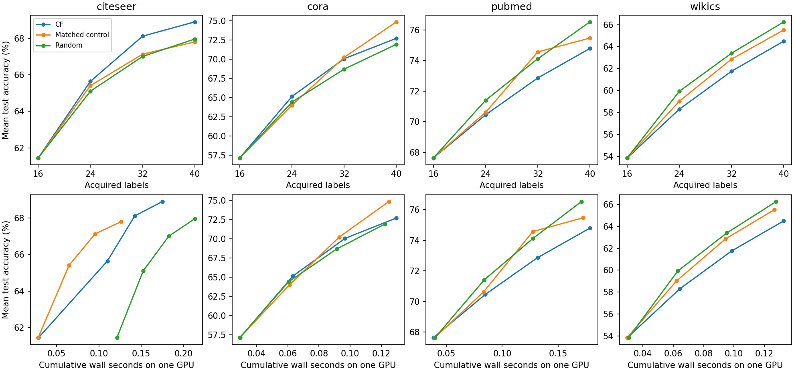

# Locked-configuration replication

Exploratory follow-up after inspecting seeds 41–45. Seeds 51–70 vary initial labels and model initialization on the original split. Values are normalized accuracy AULC in percent. Differences and unadjusted paired 95% t intervals are in percentage points.

| Dataset | CF | Matched no CF | Random | Paired Δ | 95% interval | CF wins / 20 |
| --- | --- | --- | --- | --- | --- | --- |
| citeseer | 66.31 | 65.72 | 65.60 | +0.59 | [-0.15, +1.33] | 13 |
| cora | 66.72 | 66.76 | 65.89 | -0.04 | [-0.97, +0.90] | 8 |
| pubmed | 71.51 | 72.25 | 72.54 | -0.74 | [-1.68, +0.21] | 6 |
| wikics | 59.74 | 60.52 | 61.12 | -0.78 | [-1.76, +0.21] | 8 |

